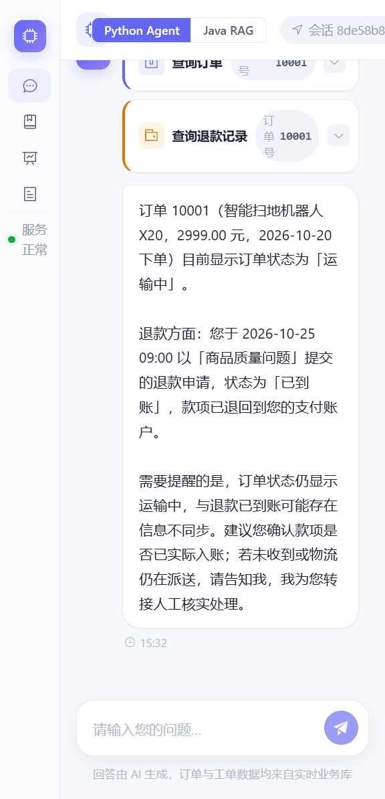
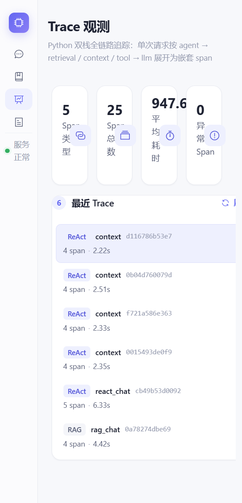
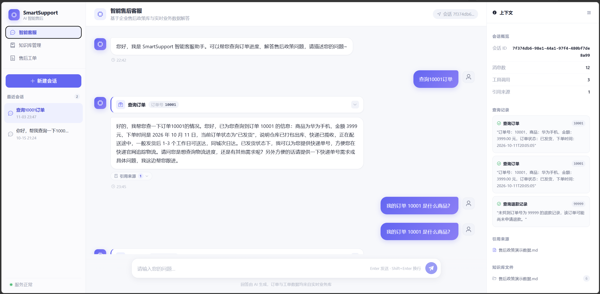
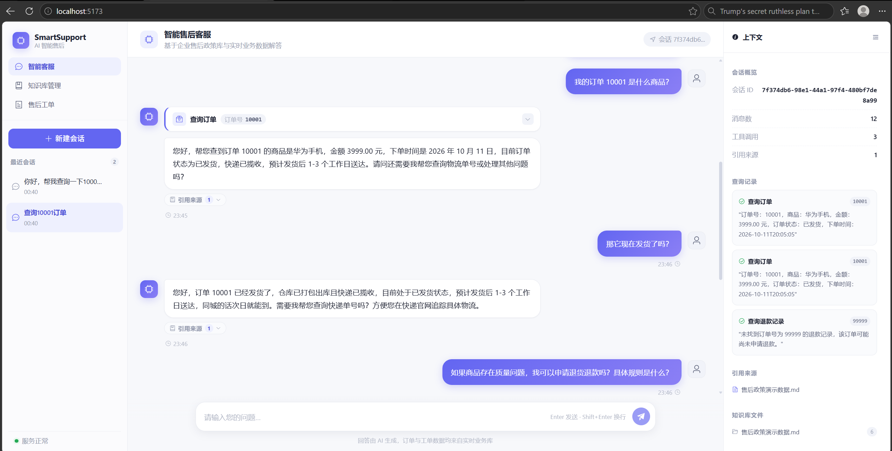
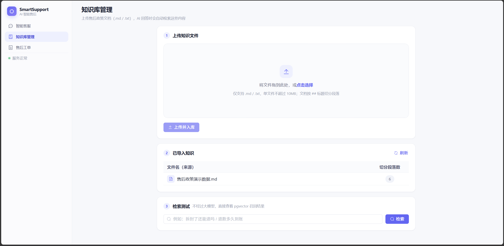
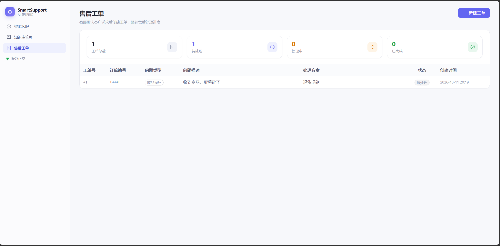
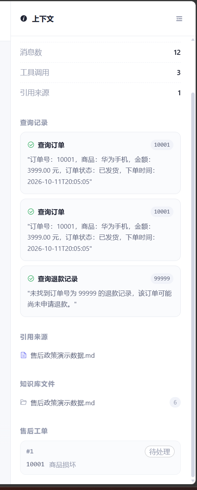

# SmartSupport AI —— 企业智能售后助手

> **Python AI 应用 + Java 业务双栈**的企业售后智能客服系统。
> **Python 侧承担 AI 应用主线**：LangGraph Agent 编排、RAG 检索与知识运营、上下文 Token 预算、Prompt 版本化回归、span 级全链路可观测、工具运行时（超时/重试/熔断/限流）、MCP 对外接入；
> Java 侧承担业务 CRUD 与只读工具服务化保障。两栈共用同一批 MySQL / Redis / pgvector / DeepSeek / 百炼 Key。
> 把售后政策文档导入向量库，让 AI 基于真实政策回答问题；再挂载订单 / 退款 / 工单查询工具，让 AI 说出**真实业务数据**而不是编造。
>
> 所有能力均由**可复现的评测**支撑：75 条检索标注用例 + 114 条 Agent 轨迹用例 + 154 个离线单测（详见[核心可量化指标](#核心可量化指标实测非估算)、[完整评测报告](docs/evaluation-report.md)）。

> 🤝 **开发方式**：本项目由本人在 Cursor、Claude Code 等 AI 编程工具辅助下完成 —— 需求拆解、技术选型、架构设计、数据库与接口设计、代码审查与本地调试验收均由本人负责；AI 工具用于代码生成、问题排查与文档整理。

[](https://www.python.org/)
[](https://fastapi.tiangolo.com/)
[](https://www.langchain.com/)
[](https://langchain-ai.github.io/langgraph/)
[](https://modelcontextprotocol.io/)
[](https://spring.io/projects/spring-boot)
[](https://docs.spring.io/spring-ai/reference/)
[](https://vuejs.org/)
[](https://openjdk.org/)
[](https://www.mysql.com/)
[](https://github.com/pgvector/pgvector)

---

## 目录

- [项目背景](#项目背景)
- [功能演示](#功能演示)
- [核心功能](#核心功能)
- [技术栈](#技术栈)
- [系统架构](#系统架构)
- [项目目录结构](#项目目录结构)
- [环境要求](#环境要求)
- [环境变量配置](#环境变量配置)
- [本地运行步骤](#本地运行步骤)
- [API 一览](#api-一览)
- [数据库说明](#数据库说明)
- [评测体系](#评测体系)
- [📊 完整评测报告](docs/evaluation-report.md)
- [开发方式与 AI 工具使用](#开发方式与-ai-工具使用)
- [注意事项](#注意事项)
- [许可证](#许可证)

---

## 项目背景

企业售后场景里，客户的问题高度集中在四类：**退不退、什么时候退、运费谁出、我的单到哪了**。

传统做法有两种，都不好用：

- **静态 FAQ**：政策一改就要改文档，答不出"我家这单什么情况"。
- **纯人工客服**：重复咨询量大，且政策口径依赖个人记忆，容易答错。

本项目的思路是**把政策和数据都交给 AI**，但给 AI 划清边界：

| 客户问题类型 | 传统做法 | 本项目的选择 |
|---|---|---|
| 政策类问题（退不退、运费谁出、保修多久） | 静态 FAQ 文档 | ✅ RAG 向量检索 + LLM 基于检索到的条文作答，**不编造政策** |
| 数据类问题（我的订单到哪了） | 客服手工查库 | ✅ Tool Calling 调用真实数据库接口，**刻意裁掉 userId** |
| 越界问题（客服电话多少） | — | 检索层挡不住，靠 system prompt 的"不编造 + 建议转人工"兜底 |

> ⚠️ 本项目中的售后政策为**模拟演示数据**，仅用于技术演示，不代表任何真实企业的实际政策。

---

## 功能演示

> 📷 以下截图均采集自本机真实运行环境（Java 后端 8080 + **Python 双栈 8001** + 前端 5173 + PostgreSQL/pgvector + Redis + MySQL），未做任何合成或伪造。
> 其中 **⑥⑦ 是 Python 侧 AI 主线**（Agent 编排与全链路追踪），**①~⑤ 是 Java 侧业务与前端**。

<table>
<tr>
<td width="50%" align="center"><b>⑥ Python Agent 工具调用（ReAct）</b></td>
<td width="50%" align="center"><b>⑦ Python span 级全链路追踪</b></td>
</tr>
<tr>
<td align="center"></td>
<td align="center"></td>
</tr>
</table>

**⑥ Python Agent 工具调用（LangGraph ReAct）** — 聊天页右上角可切换 **Python Agent / Java RAG** 两条链路。切到 Python Agent 后，提问含订单号的问题，模型自主决定调用哪些业务工具；消息气泡内展开的**工具调用卡片**显示工具名、入参与真实返回结果，最终回答由模型基于工具返回值组织：

```
订单 10001 到哪了？帮我查一下退款进度
```

这条链路对应后端 `POST /py/agent/chat/stream`：**LangGraph ReAct 编排 → 工具运行时（超时/重试/熔断/并发限流）→ 业务工具服务（Java 侧只读接口）→ 回填上下文 → 生成回答**。

**⑦ Python span 级全链路追踪（Trace 观测）** — 单次请求按 **根 span → 阶段 span → 工具子 span** 展开为树形，直接暴露耗时、Token 与召回章节：

```text
react_chat  2148.6ms                          ← 根 span：本次请求总耗时
├─ context      0.1ms  budget=4096, historyKept=0
└─ agent     2124.6ms  messageCount=5        ← LangGraph ReAct 编排
   ├─ tool      36.5ms  queryOrderByOrderNo   ← 工具子 span
   └─ tool      23.4ms  queryRefundByOrderNo
```

右上角四个指标卡是按 span 类型聚合的耗时画像，底部「慢 Span 排行」用于定位瓶颈到底在检索、上下文组装还是模型生成。这套观测由 `app/trace.py` 落库到 SQLite `trace_spans` 表，通过 `/py/ops/*` 暴露。

<table>
<tr>
<td width="50%" align="center"><b>1. 智能客服主界面</b></td>
<td width="50%" align="center"><b>2. RAG 知识库问答</b></td>
</tr>
<tr>
<td align="center"></td>
<td align="center"></td>
</tr>
</table>

**① 智能客服主界面** — 左侧为历史会话列表，右侧为聊天区。底部 2×2 快捷提问卡片全部是**政策类问题**（退款条件 / 运费承担 / 物流停滞 / 保修期限），点击后直接发送到聊天框。

**② RAG 知识库问答** — 向 AI 提问政策类问题，右侧「上下文」面板会显示命中的**引用来源**（章节文件名），回答内容完全基于检索到的条文。

可直接试的问题（来自知识库章节标题）：

- 什么情况下可以申请退款
- 退货的运费由谁承担
- 快递长时间没有更新应该怎么办
- 家电类商品保修多长时间

<table>
<tr>
<td width="50%" align="center"><b>3. Tool Calling 工具调用</b></td>
<td width="50%" align="center"><b>4. 知识库管理</b></td>
</tr>
<tr>
<td align="center"></td>
<td align="center"></td>
</tr>
</table>

**③ Tool Calling 工具调用** — 向 AI 提问含**具体订单号**的问题，消息气泡内会展开工具调用卡片，显示工具名（`查询订单` / `查询退款记录` / `查询售后工单`）、入参和真实返回结果：

```
订单 10001 到哪了？
订单 10001 的退款到账了吗？
订单 10001 的售后处理得怎么样了？
```

这些查询会**真实访问 MySQL**，AI 回答里的数据全部来自数据库，不是编的。

**④ 知识库管理** — 三个功能区：**上传知识文件**（拖拽 `.md` / `.txt`，≤10MB）、**已导入文件列表**（按来源文件分组显示段落数）、**向量检索测试**（输入问题查看相似度分数与命中段落）。

<table>
<tr>
<td align="center"><b>5. 售后工单管理</b></td>
</tr>
<tr>
<td align="center"></td>
</tr>
</table>

**⑤ 售后工单管理** — 工单列表 + 统计概览卡片（总数 / 待处理 / 处理中 / 已完成），右上角可新建工单。新建时状态留空，后端自动置为「待处理」。

> 📁 截图文件位于 `docs/screenshots/`：
> ```
> 07-python-agent.png  # Python Agent 工具调用（ReAct 编排 + 业务工具）
> 06-trace.png         # Python Trace 观测（span 调用链 + 慢 span 排行）
> 01-chat.png          # 智能客服主界面
> 02-rag.png           # RAG 知识库问答与引用来源
> 03-tool-calling.png  # Tool Calling 工具调用过程
> 04-knowledge.png     # 知识库管理页
> 05-ticket.png        # 售后工单管理页
> ```

---

## 核心功能

> 分两层组织：先讲 **⭐ Python AI 应用主线**（Agent 编排 / 上下文工程 / Prompt 版本化 / 工具可靠性 / Trace 可观测 / RAG / MCP），
> 再讲 **Java 业务与前端**（Tool Calling 后端 / 记忆 / SSE / 知识库管理 / 工单）。

### ⭐ Python AI 应用主线

#### 1. LangGraph ReAct Agent 编排（`app/workflow.py`）

- 用 `create_react_agent` 组织 **检索 → 工具 → 生成** 的自主规划循环，模型自己决定调用哪些业务工具、调用几次
- 工具调用经过 `app/tool_runtime.py` 可靠性层（超时 / 重试 / 熔断 / 限流），失败时降级为可读的字符串提示而不是抛异常
- 与固定 RAG 管线（`app/agent.py`）并存：前者适合「查订单 / 查退款」这类需要工具的问题，后者适合「政策是什么」这类知识问答
- 对外暴露 `POST /py/agent/chat`（同步）与 `POST /py/agent/chat/stream`（SSE）

#### 2. 上下文工程与 Token 预算（`app/context.py`）

模型上下文是有限预算。RAG 场景下「检索片段 + 多轮历史 + 系统提示」三者会互相挤占，超限会直接报错。

`app/context.py` 把这件事做成了**可分配、可观测**的预算器：

- `count_tokens(text)`：CJK / 拉丁混排启发式计数，不依赖 `tiktoken`（避免额外依赖与网络调用）
- `compress_context(retrieved, budget_tokens)`：**按句**截断过长片段；预算不足时**整段丢弃**低相关度尾部片段，而不是从中间切断语义
- `build_history(...)`：保留最近若干轮，超预算时从最旧的历史往回收，且强制保留最后一轮
- `assemble(...)`：统一入口，三段预算分配，返回组装结果 + `ContextStats`（含压缩节省比例、丢弃片段数）

已接入 `workflow.py` 的 ReAct 链路与 `agent.py` 的固定 RAG 管线。

#### 3. Prompt 版本化与回归比对（`app/prompts.py`）

Prompt 是代码，却极易被「顺手改一句」破坏。这里把 Prompt 当**带版本的代码资产**管：

- `PromptRegistry`：不可变注册表，按 `(name, version)` 命名空间存放，自动计算 SHA256 哈希
- `registry.diff(...)`：输出统一 diff + 增删行数，用于 code review 式评审 Prompt 改动
- `eval_prompt_regression.py`：**多轮交错执行**（候选/基线轮换，避免后端状态漂移与 API 延迟偏差），
  对忠实度 / 工具选型 / 拒答率 / 成功率 / 延迟取中位数，用**跨轮标准差**估计噪声带，超噪声带才判定 `IMPROVED` / `REGRESSED`

#### 4. 工具执行可靠性（`app/tool_runtime.py`）

Agent 调工具时工具可能卡住、失败、宕机。`ToolExecutor` 提供四层保护：
**超时控制**（8s）、**指数退避重试**（2 次）、**熔断降级**（3 次失败开闸，30s 冷却半开）、**并发限流**（8）。

两个关键实现细节：

- **同步阻塞工具必须放自管线程池**。业务工具是阻塞式 MySQL 查询，`asyncio.wait_for` 无法中断它（实测 0.5s 超时实际跑了 3s）；
  但**不能用 `asyncio.to_thread`**（它用 asyncio 默认线程池，事件循环关闭时会等池内线程结束，导致「超时后总耗时仍被拖长」）。
- **失败必须返回字符串而不是抛异常**。模型需要看到「工具失败了，请转人工」才能正确处理；抛异常会崩掉整条 ReAct 链路。

#### 5. span 级全链路 Trace（`app/trace.py`）

`ops.db` 原先只有「每次请求一行」的粗粒度日志，无法回答「到底是检索慢还是模型慢」。

`app/trace.py` 提供 **span 级别**追踪：单次请求按 **根 span → 阶段 span → 工具子 span** 展开为**嵌套树**
（`react_chat → agent → tool → tool`），通过活跃执行栈自动串联父子关系，落库 `ops.db` 的 `trace_spans` 表
（按 `trace_id` / `name` / `ts` 建索引）。

对外提供 5 个运维接口：`/py/ops/trace/{trace_id}`（完整调用链）、`/py/ops/traces`（最近列表）、
`/py/ops/slow-spans`（慢 span 排行）、`/py/ops/trace-stats`（按类型聚合的耗时画像）、`/py/ops/stats`（调用量/成功率/延迟分位/Token）。

前端「Trace 观测」页直接消费这些接口，把 span 树画成可视化调用链。

#### 6. RAG 检索与知识运营

售后政策 Markdown 文档按 `##` 标题切分成段落 → 阿里云百炼 `text-embedding-v4` 生成 1024 维向量 → 存入 PostgreSQL + pgvector。

- 四策略横向对比（dense / bm25 / hybrid / rerank），**rerank 策略胜出**：Hit@1 89.3%、NDCG@5 0.9048
- 检索异常（向量库 / Embedding 不可用）时**自动降级**为无知识回答，接口不会 500
- 命中 / 未命中走**两套不同的 system prompt**：未命中时改用「共情 + 说明现状 + 不编造 + 建议转人工」的兜底话术
- 知识运营接口：切分预览（只切不入库）、文本入库、文件上传、检索测试

#### 7. MCP 对外接入（`app/mcp_server.py`）

`python -m app.mcp_server`（stdio 协议）暴露订单 / 退款 / 工单 / 保修 4 个查询工具，
可被 Dify、Claude Desktop 等任意 MCP 客户端直接接入，把这套售后能力复用到别的应用里。

### Java 业务与前端

#### 8. Spring AI Tool Calling（工具后端实现）

三个 `@Tool` 方法把业务查询包装成 AI 可自动调用的工具，**只读，不写任何业务数据**：

| 工具名 | 对应接口 | 返回内容 |
|---|---|---|
| `queryOrderByOrderNo` | `OrderService.getByOrderNo` | 商品、金额、订单状态、下单时间 |
| `queryRefundByOrderNo` | `RefundService.getByOrderNo` | 退款原因、退款状态、申请时间 |
| `queryTicketByOrderNo` | `TicketService.getByOrderNo` | 问题类型、问题描述、处理方案、工单状态 |

模型判断问题涉及具体订单号时会自动调用这些工具。工具返回的是**自然语言文本**（而非 JSON），对 LLM 更友好。

> 🔒 **安全设计**：项目暂无登录认证体系，工具按「客服后台演示」定位实现——知道订单号即可查询。缓解措施是返回数据中**刻意裁剪掉 `userId`**，减少信息泄露面。生产环境应接入认证后校验 `order.userId == 当前用户 ID`。

#### 9. Redis 会话记忆

自定义 `RedisChatMemoryRepository` 实现 Spring AI 的 `ChatMemoryRepository`：

- Key：`chat:memory:{sessionId}`，Value：消息列表 JSON，**每次全量覆盖**并刷新 **2 小时 TTL**（过期自动清理）
- 底层 `MessageWindowChatMemory` 最多保留 **20 条消息**（约 10 轮），控制每次请求的 Token 成本
- **关键设计：只存纯文本问答对**。丢弃 `SystemMessage`（每轮重新注入，存了会重复膨胀）和**工具调用消息**（带 `toolCalls` 的 assistant / `ToolResponseMessage` 必须成对出现，被窗口裁剪拆散后 DeepSeek 会直接报 400）
- 两个 AI 接口（`/ai/chat` 与 `/ai/knowledge/chat`）**共用同一个 `ChatMemory` Bean**，同一 `sessionId` 下跨接口也能接上上下文

#### 10. SSE 流式响应

流式接口用 `SseEmitter`（300 秒超时）逐 chunk 推送，前端用 `fetch` + `ReadableStream` 手动解析 SSE：

| 接口 | 事件类型 |
|---|---|
| `POST /ai/chat/stream` | `content`（增量文本）、`done`、`error` |
| `POST /ai/knowledge/chat/stream` | `reference`（是否命中知识 + 引用来源）、`tool`（`stage=start/result`，工具名 / 入参 / 结果）、`content`、`done`、`error` |
| `POST /py/agent/chat/stream` | `tool`（`stage=start/result`）、`content`、`done` |

> ⚠️ **帧分隔符差异（实测踩坑）**：Java `SseEmitter` 用 `\n\n`，Python `EventSourceResponse` 用 `\r\n\r\n`。
> 前端解析器若只按 `\n\n` 切分，Python 流会被当成**一个巨型事件**，页面永远收不到内容。
> 现在前端统一先把 `\r\n` 归一为 `\n` 再切分。

前端 Vite 代理对 `text/event-stream` 做了 **禁缓冲**处理（`cache-control: no-cache, no-transform` + `x-accel-buffering: no`），保证逐字刷新不被代理攒包。

#### 11. 知识库管理

- **上传** `.md` / `.txt` 文件（≤10MB）→ 按 `##` 标题切段 → 批量 Embedding 入库，`metadata.source` 记为原始文件名
- **文件列表**：直接查 pgvector 的 `vector_store` 表，按 `metadata->>'source'` 分组统计段落数
- **检索测试**：输入问题直接看相似度分数与命中段落

#### 12. 售后工单管理

工单列表 + 统计概览（总数 / 待处理 / 处理中 / 已完成）+ 新建工单抽屉。创建时状态留空，后端 `TicketServiceImpl.create` 自动置为「待处理」，数据库层另有 `DEFAULT '待处理'` 兜底。

#### 13. 业务数据接口

订单 / 退款 / 工单的查询与写入接口，统一返回 `{ code, message, data }` 结构。

---

## 技术栈

### ⭐ Python AI 应用栈（主线）

> 这部分是本项目的**核心**：Agent 编排、RAG 检索与知识运营、上下文工程、Prompt 版本化回归、span 级可观测、MCP 对外接入，全部在 Python 侧实现。

| 类别 | 技术 | 说明 |
|---|---|---|
| 语言 | Python | 3.10+ |
| Web 框架 | FastAPI + uvicorn | 端口 8001，与 Java 版共用同一批中间件与 Key |
| Agent 编排 | LangChain 0.3+ / LangGraph 0.2+ | 固定 RAG 管线 + `create_react_agent` 自主规划（ReAct） |
| 上下文工程 | 自研 Token 预算器（`app/context.py`） | 系统提示 / 会话历史 / 检索片段三段预算分配，句级压缩 + 整段丢弃 |
| Prompt 工程 | 版本化注册表（`app/prompts.py`） | SHA256 版本哈希 + diff 评审 + A/B 回归比对，v2 已验证提升为默认 |
| RAG 检索 | 自研混合检索 + Rerank | 向量召回 + 章节级重排，命中即答案锚点 |
| 切分 | LangChain Text Splitters | 按 `##` 粗切、超长按 512/50 细切入库，支持切分预览 |
| 工具运行时 | 自研（`app/tool_runtime.py`） | 超时中断 + 指数退避重试 + 熔断器 + 并发限流 + 降级 |
| 协议 | MCP（FastMCP / MCPServer 2.x，stdio） | 4 个查询工具对外暴露，可供 Dify / Claude Desktop 接入 |
| 评估 | 自研检索评测 + LLM-as-Judge 生成评估 | 75 条检索标注 + 114 条 Agent 轨迹；Hit@K / MRR / **NDCG / MAP** / 忠实度 / 工具选型 / 无效调用率 |
| 可观测 | SQLite（`ops.db`）+ span 级 Trace | 延迟 p50/p95、Token、工具数、成功率 + **完整 span 调用链**（检索/上下文/工具/模型） |
| 向量库 / 记忆 | PostgreSQL + pgvector / Redis | 与 Java 版共用同一套基础设施 |

> 📁 Python 服务详情见 [`python-service/README.md`](python-service/README.md)。

### Java 业务栈（支撑）

> 这部分是**支撑**：业务 CRUD、订单/退款/工单数据模型、只读工具服务化、MCP 工具后端实现。

| 类别 | 技术 | 版本 |
|---|---|---|
| 框架 | Spring Boot | 3.4.1 |
| AI | Spring AI（DeepSeek / OpenAI 兼容 / PGVector starter） | 1.0.9 |
| 语言 | Java | 17 |
| 持久层 | MyBatis-Plus | 3.5.9 |
| 业务库 | MySQL | 8.0+ |
| 向量库 | PostgreSQL + pgvector | PG 16 |
| 缓存 / 记忆 | Redis | 7 |
| 大模型 | DeepSeek `deepseek-chat` | — |
| Embedding | 阿里云百炼 `text-embedding-v4`（1024 维） | — |
| 构建 | Maven | 3.9+ |

### 核心可量化指标（实测，非估算）

| 能力 | 指标 | 实测值 |
|---|---|---|
| 检索 | Hit@1 / Hit@5 / MRR / NDCG@5 | **89.3% / 100% / 0.9400 / 0.9048**（75 条标注用例） |
| Agent 轨迹 | pass@1 / pass@3 / 引用忠实度 | **89.5% / 96.5% / 96.5%**（114 条用例，成功率 100%） |
| 工具调用 | 无效调用率 / 浪费调用率 / 降级调用 | **0.0% / 0.0% / 0** |
| Prompt 回归 | 拒答率提升（超噪声带） | **+1.78pt**（噪声带 0.84pt，判定 IMPROVED） |
| 离线单测 | 全绿 | **154 个**，零 API 消耗 |

> 📊 每一项数字的**逐条明细、失败归因与复现命令**见 [`docs/evaluation-report.md`](docs/evaluation-report.md)。

### 前端

| 类别 | 技术 | 版本 |
|---|---|---|
| 框架 | Vue | 3.5（`<script setup>`） |
| UI | Element Plus | 2.9 |
| HTTP | Axios | 1.7 |
| 构建 | Vite | 5.4 |

---

## 系统架构

> 下图中 **Python 双栈是 AI 应用主链路**（橙色框），Java 是业务与工具服务支撑（灰色框）。
> 浏览器可以在 **Python Agent** 与 **Java RAG** 两条链路间切换。

```
┌──────────────────────────────────────────────────────────────────────────┐
│                      浏览器 (Vue 3 + Element Plus)                         │
│  智能客服 ChatView (链路切换: Python Agent / Java RAG)                     │
│  知识库管理 KnowledgeView   │   Trace 观测 TraceView   │   售后工单 TicketView │
└───────┬──────────────────────┴────────────┬─────────────┴──────────────────┘
        │ /py/* (SSE + REST)                │ /ai/* (SSE)  │ /api/*
        └───────────────────┬────────────────┴─────────────┘
                            │ Vite 代理 (5173 → 8001 / 8080)
┌───────────────────────────┴──────────────────────────────────────────────────┐
│        ⭐ Python AI 应用栈 · FastAPI (端口 8001) — AI 主链路                 │
│                                                                            │
│  ┌──────────────────────┐  ┌──────────────────┐  ┌──────────────────────┐  │
│  │  /py/agent/chat      │  │ /py/knowledge/*  │  │   /py/ops/*          │  │
│  │  (LangGraph ReAct)   │  │  (固定 RAG 管线)  │  │  Trace / 慢 span /    │  │
│  │                      │  │                  │  │  耗时画像 / 调用统计   │  │
│  └───────────┬──────────┘  └────────┬─────────┘  └──────────┬───────────┘  │
│              │                        │                       │              │
│  ┌───────────▼────────────────────────▼───────────────────────▼───────────┐  │
│  │  app/workflow.py  编排   │  app/agent.py   │  app/context.py 预算      │  │
│  │  LangGraph StateGraph    │  固定 RAG + tool │  三段 Token 预算分配      │  │
│  │  ├ 检索 → 工具 → 生成    │  loop（≤5 轮）  │  句级压缩 + 整段丢弃      │  │
│  │  └ app/prompts.py        │                 │                           │  │
│  │     Prompt 版本注册表    │                 │  app/prompts.py           │  │
│  │     SHA256 + diff + 回归 │                 │  app/trace.py  span 树     │  │
│  └───────────┬──────────────────────────────┬────────────────────────────┘  │
│              │                              │                               │
│  ┌───────────▼──────────────┐  ┌────────────▼───────────┐  ┌────────────┐  │
│  │ app/tool_runtime.py      │  │  app/retrieval.py      │  │  app/tools │  │
│  │ 超时中断 · 指数退避重试   │  │  向量召回 + 章节重排    │  │  工具协议  │  │
│  │ 熔断器 CLOSED/OPEN/HALF  │  │  (pgvector)            │  │  + 分派    │  │
│  └───────────┬──────────────┘  └────────────┬───────────┘  └─────┬──────┘  │
└──────────────┼──────────────────────────────┼────────────────────┼─────────┘
               │  只读工具调用 (HTTP)          │                    │
┌──────────────▼──────────────────────────────────────────────┐  │
│        Java 业务栈 · Spring Boot 3.4.1 (端口 8080) — 支撑      │  │
│  ┌────────────────────────┐  ┌─────────────────────────────┐ │  │
│  │ AfterSaleQueryTools     │  │ Order / Refund / Ticket    │ │  │
│  │ @Tool × 3（只读）        │  │ Controller + MyBatis-Plus  │ │  │
│  │ → OrderService          │  │ → 业务表 CRUD              │ │  │
│  │ → RefundService         │  └──────────────┬──────────────┘ │  │
│  │ → TicketService         │                 ▼                │  │
│  └────────────┬───────────┘        ┌────────────────┐        │  │
│               ▼                    │     MySQL      │        │  │
│        ┌─────────────┐             │  (smart_support)│       │  │
│        │    MySQL    │             └────────────────┘        │  │
│        └─────────────┘                                      │  │
│                                                             ▼  │
│  ┌──────────────┐   ┌────────────────┐   ┌──────────────────┐   │
│  │    Redis     │   │  PostgreSQL    │   │  DeepSeek Chat   │   │
│  │ chat:memory: │   │  + pgvector    │   │  百炼 Embedding  │   │
│  │  {sessionId} │   │  (knowledge)   │   │  (text-embedding-v4) │
│  └──────────────┘   └────────────────┘   └──────────────────┘   │
└──────────────────────────────────────────────────────────────────┘
```

### 关键设计说明

**1. 双数据源隔离**

`PgVectorDataSourceConfig` 里 MySQL 显式标 `@Primary` 保持业务代码不受影响；PG 单独用 `@Value` + `DataSourceBuilder.url()` 构建（**不能**用 `@ConfigurationProperties` 绑定 HikariCP——它的属性名是 `jdbcUrl` 而非 `url`，直接绑定会丢 url 字段并报 `jdbcUrl is required`）。同时排除 `PgVectorStoreAutoConfiguration`，防止向量误写进 MySQL。

**2. 提示词拆两段**

system 指令每轮重新注入（**不进历史**），user 问题单独进历史。这样 Redis 里存的是干净的问答对，不会把大段政策上下文重复塞进每一轮历史，省 Token。

**3. `RetryableChatModel` 重试兜底**

JDK HttpClient 复用被对端关闭的连接会收到 RST（表现为 `Connection reset`）。Spring AI 的流式路径缺少重试，该装饰器在**尚未吐出任何内容时**做指数退避重试（最多 2 次，初始 1s、上限 4s，且只对瞬时网络错误生效），重试发生在记忆顾问内侧，不会重复写入聊天记忆。同步路径则由 `spring.ai.retry` 负责（`max-attempts: 5`，不开启 `on-client-errors`，避免重试 401 这类不可恢复错误）。

**4. 检索层不拦截越界问题**

`threshold=0.0` 时检索层挡不住越界问题（详见评测报告），这是**已知局限**，兜底靠 LLM 的 system prompt 而非检索层。

---

## 项目目录结构

```
.
├── README.md                       # 本文件
├── .env.example                    # 环境变量清单（仅供参考，见下文说明）
├── .gitignore                      # 统一忽略规则
├── 售后政策演示数据.md              # RAG 知识库源文档（模拟政策）
│
├── python-service/                 # ===== ⭐ Python AI 应用栈（FastAPI，端口 8001）=====
│   ├── README.md                   # Python 服务说明（含接口/评测/可观测/MCP）
│   ├── requirements.txt
│   ├── app/                        # FastAPI 应用
│   │   ├── main.py                 # /py/* 接口（RAG/Agent/知识运营/ops）
│   │   ├── workflow.py             # ★ LangGraph ReAct Agent 编排
│   │   ├── agent.py                # 固定 RAG 管线（与 Java 同语义）
│   │   ├── context.py              # ★ 上下文工程：Token 预算分配 + 片段压缩
│   │   ├── prompts.py              # ★ Prompt 版本注册表（哈希 + diff + 生效版本）
│   │   ├── trace.py                # ★ span 级全链路追踪（SQLite trace_spans）
│   │   ├── tool_runtime.py         # ★ 工具可靠性层（超时/重试/熔断/限流）
│   │   ├── ingest.py               # ## 粗切 + 512/50 细切入库
│   │   ├── tools.py                # 订单/退款/工单/保修 4 工具
│   │   ├── vectorstore.py          # pgvector 检索（topK/threshold）
│   │   ├── memory.py               # Redis 会话记忆（与 Java 共用 key）
│   │   ├── metrics.py              # SQLite 可观测落库
│   │   └── mcp_server.py           # MCP stdio 服务（4 工具对外）
│   └── eval/                       # 评测与离线单测（154 个，全绿）
│       ├── eval_retrieval.py       # 检索策略横向对比（75 条，零 LLM 消耗）
│       ├── eval_agent.py           # Agent 轨迹级评测（114 条）
│       ├── eval_prompt_regression.py # ★ Prompt A/B 回归（多轮交错 + 噪声带）
│       ├── metrics_ndcg.py         # ★ NDCG / MAP（分级相关性）
│       ├── eval_answer.py          # 端到端生成评估（LLM-as-Judge）
│       ├── test_context.py         # 上下文预算器单测（31）
│       ├── test_prompt_version.py  # Prompt 版本注册表单测（22）
│       ├── test_ndcg.py            # NDCG/MAP 单测（41）
│       ├── test_trace.py           # Trace span 单测（26）
│       ├── test_tool_runtime.py    # 工具可靠性单测（13）
│       ├── test_eval_agent.py      # 轨迹解析单测（15）
│       └── test_rerank_authority.py # 重排权威度单测（6）
│
├── backend/                        # ===== Java 业务栈（Spring Boot，端口 8080）=====
│   ├── pom.xml                     # Maven 依赖与版本管理
│   ├── docker-compose.yml          # Redis + PostgreSQL/pgvector 编排
│   ├── eval/                       # RAG 评测
│   │   ├── RAG-评测报告.md          # 完整评测报告
│   │   ├── gen-report.mjs          # 报告生成脚本
│   │   └── analyze-threshold.mjs   # 阈值扫描分析
│   └── src/
│       ├── main/
│       │   ├── java/com/smartsupport/
│       │   │   ├── SmartSupportApplication.java   # 启动类
│       │   │   ├── ai/
│       │   │   │   ├── AiChatController.java      # /ai/chat, /ai/chat/stream
│       │   │   │   ├── AiKnowledgeController.java # /ai/knowledge/*
│       │   │   │   ├── RetryableChatModel.java    # 流式重试装饰器
│       │   │   │   ├── RedisChatMemoryRepository.java # Redis 记忆实现
│       │   │   │   └── tool/AfterSaleQueryTools.java # 3 个 @Tool 查询工具
│       │   │   ├── config/
│       │   │   │   ├── ChatMemoryConfig.java       # MessageWindowChatMemory
│       │   │   │   ├── PgVectorDataSourceConfig.java # MySQL @Primary + PG 独立
│       │   │   │   └── PgVectorStoreConfig.java    # 手建 PgVectorStore
│       │   │   ├── controller/                      # Health / Order / Refund / Ticket
│       │   │   ├── entity/                         # Order / RefundRecord / AfterSaleTicket
│       │   │   ├── mapper/                         # BaseMapper × 3
│       │   │   ├── service/                        # 接口 + impl
│       │   │   ├── eval/RagEvalController.java     # /eval/rag/*
│       │   │   └── common/Result.java              # 统一返回结构
│       │   └── resources/
│       │       ├── application.yml                 # 所有配置
│       │       ├── db/schema.sql                   # ★ MySQL 初始化脚本
│       │       ├── eval/rag-eval-cases.json        # 评测用例集（33 条）
│       │       └── knowledge/*.txt                 # 知识库样例文档
│       └── test/java/.../RetryableChatModelTest.java # JUnit 5 + AssertJ
│
├── frontend/                       # ===== 前端 =====
│   ├── package.json
│   ├── vite.config.js              # 代理 /py → 8001，/ai 与 /api → 8080，SSE 禁缓冲
│   └── src/
│       ├── main.js  App.vue
│       ├── api/                    # axios 封装 + chat/ticket/knowledge/trace
│       ├── components/             # 17 个通用组件
│       ├── views/                  # ChatView / KnowledgeView / TraceView / TicketView
│       └── styles/                 # theme / chat / index
│
└── docs/
    └── screenshots/                # ★ README 截图
        ├── 07-python-agent.png     # Python Agent 工具调用（ReAct）
        ├── 06-trace.png            # Python Trace 观测（span 调用链）
        ├── 01-chat.png
        ├── 02-rag.png
        ├── 03-tool-calling.png
        ├── 04-knowledge.png
        └── 05-ticket.png
```

---

## 环境要求

| 依赖 | 版本要求 | 说明 |
|---|---|---|
| **Python** | **3.10+** | ⭐ Python AI 应用栈（FastAPI / LangChain / LangGraph）最低要求 |
| **JDK** | **17+** | Spring Boot 3.x 最低要求 |
| **Maven** | 3.6+ | 或使用项目内 `.tools/apache-maven-3.9.9` |
| **Node.js** | 18+ | Vite 5 要求 |
| **MySQL** | **8.0+** | 见下方[数据库说明](#数据库说明) |
| **PostgreSQL + pgvector** | PG 16 + pgvector | 官方推荐用 Docker 启动 |
| **Redis** | 7.x | 官方推荐用 Docker 启动 |
| **Docker / Docker Compose** | 建议 | 用于一键起 PG + Redis |

### 关于 API Key

需要两个第三方 Key：

- **DeepSeek** — 用于对话与工具调用，https://platform.deepseek.com/api_keys
- **阿里云百炼** — 用于 Embedding，https://bailian.console.aliyun.com/

---

## 环境变量配置

> ⚠️ **重要：`.env.example` 仅供参考，Spring Boot 不会自动读取 `.env` 文件。**
>
> `.env.example` 只是一个**变量名清单**，用于让你知道需要哪些变量、对应到哪个配置项。Spring Boot 不会加载 `.env`，所以**照抄 `.env.example` 并不会让配置生效**。你必须把变量**真正设置到系统环境变量里**，或用启动参数 / JVM 参数显式传入。
>
> `.env` 文件本身只对 **Docker Compose** 有效（`docker-compose.yml` 会自动读取同目录的 `.env`），对 Spring Boot 无效。
>
> 同理，`application.yml` 里的 `${DEEPSEEK-KEY}` 写法依赖**真实环境变量名**，而不是 `.env` 文件里的 `DEEPSEEK-KEY=` 这一行。

### 需要设置的 4 个变量

| 变量名 | 用途 | 对应配置项 | 缺失后果 |
|---|---|---|---|
| `DEEPSEEK-KEY` | DeepSeek 对话模型 | `spring.ai.deepseek.api-key` | AI 接口返回"AI 调用失败" |
| `ALIYUN-KEY` | 百炼 Embedding | `spring.ai.openai.embedding.api-key` | RAG 检索降级为空，无引用来源 |
| `MYSQL_PASSWORD` | MySQL root 密码 | `spring.datasource.password` | **应用启动失败**（刻意设计） |
| `PG_PASSWORD` | PostgreSQL 密码 | `pgvector.datasource.password` + compose 的 `POSTGRES_PASSWORD` | 向量库连接失败 / compose 报错退出 |

### Windows PowerShell（当前会话生效）

```powershell
$env:DEEPSEEK-KEY="sk-your-deepseek-key"
$env:ALIYUN-KEY="sk-your-bailian-key"
$env:MYSQL_PASSWORD="your-mysql-root-password"
$env:PG_PASSWORD="your-postgres-password"
```

### Windows CMD（当前会话生效）

```cmd
set DEEPSEEK-KEY=sk-your-deepseek-key
set ALIYUN-KEY=sk-your-bailian-key
set MYSQL_PASSWORD=your-mysql-root-password
set PG_PASSWORD=your-postgres-password
```

### Linux / macOS

```bash
export DEEPSEEK-KEY="sk-your-deepseek-key"
export ALIYUN-KEY="sk-your-bailian-key"
export MYSQL_PASSWORD="your-mysql-root-password"
export PG_PASSWORD="your-postgres-password"
```

### 永久生效（Windows 系统级）

```
「此电脑」右键 → 属性 → 高级系统设置 → 环境变量 → 新建/编辑上述 4 个变量
```

> 💡 也可以不用环境变量，改为启动时传参（覆盖 `application.yml`）：
>
> ```powershell
> mvn spring-boot:run "-Dspring-boot.run.jvmArguments=-DMYSQL_PASSWORD=xxx -DDEEPSEEK-KEY=xxx"
> ```
>
> 注意 `DEEPSEEK-KEY` 含连字符，在 PowerShell 中作为环境变量名可用，但在 JVM `-D` 参数里建议改用 `-Dspring-boot.run.arguments=--spring.ai.deepseek.api-key=xxx`。

### Docker Compose 用的 `.env`

只有 **Docker Compose** 会读 `.env` 文件。由于 `docker-compose.yml` 位于 `backend/` 且执行命令是 `cd backend && docker compose up -d`，请把 `.env` 放在 **`backend/` 目录**下：

```bash
cd backend
cp ../.env.example .env      # Linux / macOS
copy ..\.env.example .env    # Windows
```

然后编辑 `backend/.env` 填入真实值（**该文件已被 `.gitignore` 排除，不会提交**）。

> ⚠️ 但这只解决 compose 的问题，**Spring Boot 侧仍需按上面的方式设置系统环境变量**——compose 读到的 `.env` 不会传递给 JVM 进程。

---

## 本地运行步骤

### 步骤 1 — 启动 PostgreSQL + Redis（Docker Compose）

```bash
cd backend
docker compose up -d
```

启动后：

- PostgreSQL + pgvector → `localhost:5432`，数据库 `knowledge`，用户 `postgres`
- Redis → `localhost:6379`

> ⚠️ `docker-compose.yml` 中 `POSTGRES_PASSWORD: ${PG_PASSWORD:?PG_PASSWORD is required}` —— **未提供 `PG_PASSWORD` 时 compose 会直接报错退出**，这是刻意设计，避免使用弱口令默认值。所以执行前请先设置好 `PG_PASSWORD` 环境变量（或在 `backend/.env` 里配置）。

验证：

```bash
docker compose ps
```

> 💡 **pgvector 扩展无需手动创建**。`PgVectorStoreConfig` 里设了 `initializeSchema(true)`，Spring AI 首次启动时会自动执行 `CREATE EXTENSION IF NOT EXISTS vector` / `hstore` / `"uuid-ossp"` 并建好 `vector_store` 表。前提是 `postgres` 用户有建扩展的权限（官方 `pgvector/pgvector` 镜像默认具备）。

停止 / 清理：

```bash
docker compose stop          # 停止
docker compose down         # 停止并删除容器
docker compose down -v      # 连同数据卷一起删除（会清空向量库）
```

### 步骤 2 — 初始化 MySQL 数据库

项目使用**本机安装的 MySQL 8.0**（不使用 Docker），库名 `smart_support`。

> ⚠️ **数据库初始化脚本需要 MySQL 8.0 及以上**。
>
> 脚本使用了 `utf8mb4_0900_ai_ci` 排序规则和 MySQL 8.0.19+ 引入的 `INSERT ... AS alias` 行别名语法，**在 MySQL 5.7 上会直接报语法错误**。如果你的环境是 5.7，请把排序规则改为 `utf8mb4_general_ci`，并把 `ON DUPLICATE KEY UPDATE` 中的 `demo.\`col\`` 改回 `VALUES(\`col\`)`。

**方式 A（推荐，一条命令完成建库 + 建表 + 灌数据）**

```bash
mysql -u root -p < backend/src/main/resources/db/schema.sql
```

脚本内部已经包含 `CREATE DATABASE IF NOT EXISTS smart_support` 和 `USE smart_support`，无需预先建库。

**方式 B（先建库，再执行）**

```bash
mysql -u root -p -e "CREATE DATABASE IF NOT EXISTS smart_support DEFAULT CHARACTER SET utf8mb4;"
mysql -u root -p smart_support < backend/src/main/resources/db/schema.sql
```

**方式 C（Navicat / MySQL Workbench 图形化执行）**

1. 连接本机 MySQL 8.0
2. 打开 `backend/src/main/resources/db/schema.sql`
3. 直接运行整个脚本

**脚本行为说明**

- 建表使用 `CREATE TABLE IF NOT EXISTS` —— 表已存在则跳过，**不清空已有数据**
- 演示数据使用 `INSERT ... ON DUPLICATE KEY UPDATE` —— 遇到主键或 `order_no` 唯一键冲突时**更新该行**，而不是报错或插入重复行
- **脚本内不含 `DROP TABLE`，也不含 `DELETE FROM`**，不会删除库中其他数据
- 时间全部为**固定字面量**（不含 `NOW()`），保证演示数据可复现，并能体现"超时未发货""运输超时"等依赖时间差的业务场景
- ⚠️ 重复执行时，**相同订单编号（如 `10001`）的演示数据会被覆盖更新**为脚本中定义的商品、金额、状态与时间

**演示数据内容**

| 表 | 行数 | 覆盖状态 |
|---|---|---|
| `orders` | 7 | 已下单×2、已发货×1、运输中×2、已完成×2 |
| `refund_record` | 3 | 审核中×1、已退款×1、已到账×1 |
| `after_sale_ticket` | 4 | 待处理×2、处理中×1、已完成×1 |

其中 **`order_no = '10001'`** 是主锚点：三个查询工具的 `@ToolParam` 示例值都是 `10001`，保证 AI 演示时能查到真实数据。订单号 `10001`~`10007` 均能通过 `/api/order/{orderNo}` 访问。

### 步骤 3 — 启动 Java 业务栈（Spring Boot，端口 8080）

```bash
cd backend
mvn spring-boot:run
```

或者：

```bash
cd backend
mvn clean package -DskipTests
java -jar target/smart-support-backend-1.0.0.jar
```

后端监听 **8080**。验证：

```bash
curl http://localhost:8080/health
curl http://localhost:8080/db-check
curl http://localhost:8080/api/order/list
```

> `db-check` 会实际执行 `SELECT VERSION()` 和 `SELECT DATABASE()`，能返回结果就说明网络通、账号密码对、库存在。

> 💡 若你的机器没装 Maven，可用项目内置的 Maven 发行版（Windows）：
>
> ```powershell
> .tools\apache-maven-3.9.9\bin\mvn.cmd spring-boot:run
> ```
>
> 注意 `.tools/` 已被 `.gitignore` 排除，**只有本地开发机才有**，克隆仓库的其他人需自备 Maven。

### 步骤 4 — 导入知识库到向量库

后端启动后，把售后政策导入 pgvector（**任选一条接口，Java / Python 均可**，两套写入格式一致）：

```bash
# Java 侧（读取 ../售后政策演示数据.md）
curl -X POST http://localhost:8080/ai/knowledge/import-policy

# Python 侧（source 不传时默认 upload.txt）
curl -X POST http://localhost:8001/py/knowledge/import-text \
  -H "Content-Type: application/json" \
  -d "{\"content\":\"$(cat ../售后政策演示数据.md)\",\"source\":\"售后政策演示数据.md\",\"replace\":true}"
```

或者在**前端「知识库管理」页**上传 `.md` / `.txt` 文件。

> `import-policy` 默认读取 `../售后政策演示数据.md`（相对 `backend/` 运行目录，即项目根目录下的政策文档）。可用配置项 `smartsupport.knowledge.policy-file` 覆盖路径。

### 步骤 5 — 启动 Python AI 应用栈（FastAPI，端口 8001）

Python 服务与 Java 版**共用同一批中间件与 Key**（MySQL / Redis / pgvector / DeepSeek / 百炼），提供 ReAct Agent、上下文预算、Prompt 版本化回归、span 级可观测、知识运营、MCP 与生成评估能力。

```powershell
cd python-service
pip install -r requirements.txt

$env:DEEPSEEK_API_KEY="sk-..."   # 或 DEEPSEEK-KEY（二选一）
$env:ALIYUN_API_KEY="sk-..."     # 或 ALIYUN-KEY（二选一）
$env:MYSQL_PASSWORD="..."
$env:PG_PASSWORD="..."

python -m uvicorn app.main:app --port 8001
```

验证：`curl http://localhost:8001/health`，详情见 [`python-service/README.md`](python-service/README.md)。

### 步骤 6 — 启动前端

```bash
cd frontend
npm install
npm run dev
```

前端监听 **5173**，访问 http://localhost:5173 。

Vite 已配置代理：`/py` 转发到 `http://localhost:8001`（Python 双栈），`/ai` 与 `/api` 转发到 `http://localhost:8080`（Java），开发环境不产生跨域问题。SSE 响应做了禁缓冲处理，可正常逐字刷新。

> 💡 聊天页右上角可在 **Python Agent / Java RAG** 两条链路间切换；「Trace 观测」页直接读 Python 侧的 span 调用链。

### 步骤 7 — 运行单元测试

```bash
# Python AI 应用栈（154 个离线单测，零 API 消耗）
cd python-service
python eval/test_context.py
python eval/test_prompt_version.py
python eval/test_ndcg.py
python eval/test_trace.py
python eval/test_tool_runtime.py
python eval/test_eval_agent.py
python eval/test_rerank_authority.py

# Java 业务栈
cd backend
mvn test
```

Java 侧 `RetryableChatModelTest` 覆盖流式重试逻辑（JUnit 5 + AssertJ）。

---

## API 一览

所有接口统一返回 `{ code, message, data }`，`code=200` 表示成功。

### ⭐ Python AI 应用栈（FastAPI 8001，`/py/*`）

> AI 应用主链路接口。`/py/agent/*` 是 LangGraph ReAct Agent，`/py/ops/*` 是 span 级可观测。

| 方法 | 路径 | 说明 |
|---|---|---|
| GET | `/health` | Python 服务存活检查 |
| POST | `/py/agent/chat` / `/py/agent/chat/stream` | ⭐ LangGraph ReAct Agent（自主规划多工具调用，SSE 含 tool/content/done） |
| POST | `/py/knowledge/chat` / `/py/knowledge/chat/stream` | 固定 RAG 管线（与 Java 同语义，SSE 含 reference/tool/content/done） |
| GET | `/py/knowledge/search?query=&topK=` | 向量检索测试 |
| POST | `/py/knowledge/preview-split` | 只切分不入库，预览 chunk 效果 |
| POST | `/py/knowledge/import-text` | 文本切分→embedding→pgvector 入库 |
| POST | `/py/knowledge/upload` | 上传 md/txt 并入库（multipart，字段名 `file`） |
| GET | `/py/ops/stats` | 调用量/成功率/延迟 p50/p95/Token/工具均值/分链路统计 |
| GET | `/py/ops/recent?limit=` | 最近调用明细 |
| GET | `/py/ops/trace/{trace_id}` | 单次请求的完整 span 调用链（父子关系 + 各段耗时） |
| GET | `/py/ops/traces?limit=` | 最近 trace 列表 |
| GET | `/py/ops/slow-spans?thresholdMs=` | 慢 span 排行（性能瓶颈定位） |
| GET | `/py/ops/trace-stats` | 按 span 类型聚合的耗时画像 |

### 健康检查

| 方法 | 路径 | 说明 |
|---|---|---|
| GET | `/health` | 应用存活检查 |
| GET | `/db-check` | MySQL 连通性检查（实际执行 SQL） |

### AI 对话（Java）

| 方法 | 路径 | 说明 |
|---|---|---|
| POST | `/ai/chat` | 同步对话（带 RAG + 记忆 + 工具） |
| POST | `/ai/chat/stream` | SSE 流式对话 |

请求体：`{"message": "你好", "sessionId": "可选，续聊时传上次返回的 sessionId"}`

### AI 知识库（Java）

| 方法 | 路径 | 说明 |
|---|---|---|
| POST | `/ai/knowledge/import-policy` | 导入售后政策文档到向量库 |
| POST | `/ai/knowledge/upload` | 上传 md/txt 并入库（multipart，字段名 `file`） |
| GET | `/ai/knowledge/files` | 已导入文件列表（含段落数） |
| GET | `/ai/knowledge/search?query=` | 向量检索测试 |
| POST | `/ai/knowledge/chat` | 同步问答（带 RAG + 记忆 + 工具） |
| POST | `/ai/knowledge/chat/stream` | SSE 流式问答（多 `reference` / `tool` 事件） |

请求体：`{"question": "退款需要多久到账", "sessionId": "可选"}`

### 业务数据

| 方法 | 路径 | 说明 |
|---|---|---|
| GET | `/api/order/list` | 订单列表 |
| GET | `/api/order/{orderNo}` | 订单详情 |
| POST | `/api/order` | 新增订单 |
| GET | `/api/refund/list` | 退款记录列表 |
| GET | `/api/refund/{orderNo}` | 退款记录详情 |
| GET | `/api/ticket/list` | 工单列表 |
| GET | `/api/ticket/{orderNo}` | 工单详情 |
| POST | `/api/ticket` | 创建工单（status 留空 → 「待处理」） |

### RAG 评测（Java）

| 方法 | 路径 | 说明 |
|---|---|---|
| GET | `/eval/rag/knowledge-base` | 知识库信息 |
| GET | `/eval/rag/dataset` | 评测用例集 |
| POST | `/eval/rag/run?topKs=&thresholds=` | 批量评测（**只读**，仅对 `vector_store` 做 SELECT） |

---

## 数据库说明

MySQL 业务库 `smart_support`，三张表通过 `order_no` **字符串逻辑关联**，**不建物理外键**（代码中无任何 JOIN，外键对代码零收益，反而会阻塞删除并增加部署摩擦）。

| 表名 | 主键 | 唯一索引 | 列数 |
|---|---|---|---|
| `orders` | `id` BIGINT AUTO_INCREMENT | `uk_order_no (order_no)` | 7 |
| `refund_record` | `id` BIGINT AUTO_INCREMENT | `uk_refund_order_no (order_no)` | 5 |
| `after_sale_ticket` | `id` BIGINT AUTO_INCREMENT | `uk_ticket_order_no (order_no)` | 7 |

### 为什么 `order_no` 必须有唯一索引？

业务层查询用的是 `selectOne`：

```java
orderMapper.selectOne(new LambdaQueryWrapper<Order>().eq(Order::getOrderNo, orderNo));
```

MyBatis-Plus 的 `selectOne` **不带 `LIMIT 1`**，命中多行时直接抛 `TooManyResultsException` → HTTP 500。没有唯一约束，重复的 `order_no` 会让查询接口直接报错。

> 💡 业务上"一单一退"是当前实现的假设。若未来放开为"一单多笔退款"，唯一索引与 `selectOne` 需同步改造。

### 表结构

<details>
<summary><b>orders（订单表）</b></summary>

| 字段 | 类型 | 约束 | 说明 |
|---|---|---|---|
| `id` | BIGINT | PK, AUTO_INCREMENT | 订单 ID |
| `order_no` | VARCHAR(20) | NOT NULL, UNIQUE | 订单编号，如 `10001` |
| `user_id` | BIGINT | NULL | 下单用户 ID（无对应用户表） |
| `product_name` | VARCHAR(100) | NULL | 商品名称 |
| `amount` | DECIMAL(10,2) | NULL | 订单金额（BigDecimal，不用 DOUBLE） |
| `status` | VARCHAR(20) | NOT NULL | 已下单 / 已发货 / 运输中 / 已完成 |
| `create_time` | DATETIME | NOT NULL | 下单时间 |

</details>

<details>
<summary><b>refund_record（退款记录表）</b></summary>

| 字段 | 类型 | 约束 | 说明 |
|---|---|---|---|
| `id` | BIGINT | PK, AUTO_INCREMENT | 退款记录 ID |
| `order_no` | VARCHAR(20) | NOT NULL, UNIQUE | 关联订单编号 |
| `refund_reason` | VARCHAR(255) | NULL | 退款原因 |
| `refund_status` | VARCHAR(20) | NULL | 审核中 / 已退款 / 已到账 |
| `create_time` | DATETIME | NOT NULL | 申请时间 |

</details>

<details>
<summary><b>after_sale_ticket（售后工单表）</b></summary>

| 字段 | 类型 | 约束 | 说明 |
|---|---|---|---|
| `id` | BIGINT | PK, AUTO_INCREMENT | 工单 ID |
| `order_no` | VARCHAR(20) | NOT NULL, UNIQUE | 关联订单编号 |
| `problem_type` | VARCHAR(50) | NULL | 问题类型：商品质量问题 / 七天无理由退货 / 物流问题 / 保修 / 其他 |
| `description` | VARCHAR(1000) | NULL | 问题描述 |
| `solution` | VARCHAR(1000) | NULL | 处理方案 |
| `status` | VARCHAR(20) | NOT NULL, DEFAULT `'待处理'` | 待处理 / 处理中 / 已完成 |
| `create_time` | DATETIME | NOT NULL | 创建时间 |

</details>

> ⚠️ MyBatis-Plus 依赖 `map-underscore-to-camel-case: true`（见 `application.yml`），列名必须严格保持小写下划线形式。

---

## 评测体系

> 📊 **完整评测报告**：[`docs/evaluation-report.md`](docs/evaluation-report.md)
> 包含四种召回策略的逐项横向对比、114 条 Agent 用例的分类别表现与失败归因、Prompt 回归的中位数与噪声带判定过程、span Trace 的实测数据，以及全部数字的复现命令与成本说明。

项目的评测分两层：**Python AI 应用栈**是主力（检索质量 + Agent 轨迹 + Prompt 回归 + 单测），**Java 业务栈**保留一套基础检索评测做交叉验证。

### ⭐ Python AI 应用栈评测（`python-service/eval/`）

| 评测 | 用例规模 | 关键结果 |
|---|---|---|
| **检索评测**（`eval_retrieval.py`） | 75 条标注 + 15 条越界 | Rerank 策略 **Hit@1 89.3%、Hit@5 100%、MRR 0.9400、NDCG@5 0.9048**；四策略横向对比 dense / bm25 / hybrid / rerank |
| **Agent 轨迹评测**（`eval_agent.py`） | 114 条 = 政策63 + 工具24 + 口语8 + 越界19 | **pass@1 89.5%、pass@3 96.5%、引用忠实度 96.5%**、执行成功率 100%、**无效调用率 0.0%、浪费调用率 0.0%、降级调用 0**、平均步数 0.87 |
| **Prompt 回归比对**（`eval_prompt_regression.py`） | 84 条 × 2 轮 × 2 版本交错执行 | `rag_system:v1` vs `v2`：忠实度 97.0% → 97.6%（无退化）、**拒答率 +1.78pt > 0.84pt 噪声带 → IMPROVED**，故 `v2` 提升为默认版本 |
| **离线单测** | 154 个 | context 31 / prompt 22 / ndcg 41 / trace 26 / tool_runtime 13 / eval_agent 15 / rerank 6 —— **零 API 消耗** |

**评测方法要点：**

- ground truth 用**章节标题**（chunk 正文首行 `## xxx`），不用 chunk id —— 向量库 id 由 `uuid_generate_v4()` 随机生成、跨次导入不稳定
- **严格只读**：对 `vector_store` 只有 `SELECT`，不做任何写入 / 删除 / 重置
- NDCG 采用**分级相关性**（Primary=3 / Secondary=2 / Tertiary=1 / Distractor=-1 / None=0），专门区分「命中正确章节」与「命中近似干扰章节」；干扰项会按 `expectedSections` 顺序受罚
- 检索评测 **零 LLM 消耗**（只跑向量检索 + 重排），因此可以高频回归

**上下文工程**（`app/context.py`）：Token 预算三段分配 + 句级压缩 + 整段丢弃，已接入 ReAct 与固定 RAG 两条链路。

**可观测**：每次 `/py/knowledge/chat` 与 `/py/agent/chat` 落库 SQLite（`ops.db`），`/py/ops/stats` 看调用量/成功率/延迟 p50/p95/Token/工具均值/RAG 命中率/分链路统计；另提供 **span 级 Trace**（`/py/ops/trace/{trace_id}`、`/py/ops/slow-spans`、`/py/ops/trace-stats`），可下钻到「单次请求里检索、上下文组装、工具调用、模型生成各耗时多少」。

**MCP**：`python -m app.mcp_server`（stdio）暴露订单/退款/工单/保修 4 工具，可供 Dify / Claude Desktop 接入。

> 📌 **一个重要的方法论教训**：初版评测参考答案只写了 1 句摘要，模型引用完整条款反被判 `HALLUCINATION`，pass@1 一度只有 64.9%。修复参考答案质量 + 裁判 Prompt 后，pass@1 提升到 89.5%、幻觉从 35 条降到 4 条。

### Java 业务栈检索评测（`backend/eval/`）

评测集共 **33 条**用例 = **29 条可答用例** + **4 条越界探针**。

**生产配置（`topK=5, threshold=0.0`）实测结果：**

| 指标 | 数值 |
|---|---|
| Hit Rate@1 | 89.7%（26/29） |
| Hit Rate@3 | 100.0%（29/29） |
| MRR | 0.9483 |
| 平均检索延迟 | 271.0 ms |
| 最大检索延迟 | 783.9 ms |

**完整报告：** [`backend/eval/RAG-评测报告.md`](backend/eval/RAG-评测报告.md)
> **评测集本身的质量决定了评测结论的可信度** —— 这比调 Prompt 更值得记录。

---

## 开发方式与 AI 工具使用

本项目**不是**纯手写，也不是完全交给 AI 生成，而是"人做决策、AI 做加速"的协作方式：

| 环节 | 由谁负责 |
| --- | --- |
| 需求拆解与场景定义（退换货政策问答 / 订单数据查询 / 越界拒答） | 本人 |
| 技术选型（FastAPI + LangGraph 为 AI 主线，Spring Boot 为业务 CRUD 保障，pgvector 向量库） | 本人 |
| 架构设计（Java / Python 双栈职责划分、共享 MySQL / Redis / pgvector） | 本人 |
| 数据库表结构与接口契约设计 | 本人 |
| Prompt 策略、检索切分参数（512/50）、topK / 阈值、越界兜底策略 | 本人 |
| **上下文预算策略（系统提示 / 会话历史 / 检索片段三段配额分配）** | 本人 |
| **评测集构建（75 条检索标注 + 114 条 Agent 轨迹）与评测方法设计** | 本人 |
| **Prompt 版本化策略与回归判定规则（噪声带阈值）** | 本人 |
| **span 追踪埋点设计与运维接口设计** | 本人 |
| 代码生成与重构 | 本人主导，AI 工具辅助 |
| 问题排查、性能调优、本地联调与验收 | 本人主导，AI 工具辅助 |
| README 与评测报告撰写 | 本人主导，AI 工具辅助 |

**实际使用的 AI 工具**：Cursor（Agent / Composer）、Claude Code —— 主要用于模板生成、重复代码编写、单测补全、报错定位与文档整理。

**为什么把这个写出来**：现在绝大多数开发者都在用 AI 编程工具，能主动讲清楚"哪些是我决定的、哪些是 AI 做的"，比声称"全部手写"更真实，也更能体现工程判断力。

> **关于评测的特别说明**：本项目的评测脚本、参考答案、指标定义与判定阈值均由本人设计与实现，
> 并通过**参考集质量修复**（初版 1 句摘要导致 35 条误判幻觉）与**裁判稳定性复跑**（12 条 0 翻转）
> 排除了评测本身的系统性偏差。报告里的每个数字都可以用 `python -m eval.xxx` 复现。

---

## 注意事项

### 安全相关

1. **不要提交任何真实密钥**。`.env` 已被 `.gitignore` 排除，`.env.example` 只放变量名与占位符。
2. **`MYSQL_PASSWORD` 未设置时应用会启动失败**——这是刻意设计，避免把明文密码写进版本库。
3. **`docker-compose.yml` 无弱口令默认值**，`PG_PASSWORD` 缺失时 compose 直接报错退出。
4. **查询工具无鉴权**。项目暂无登录体系，知道订单号即可查询。缓解措施是返回数据裁掉 `userId`。**生产环境必须接入认证后校验 `order.userId == 当前用户 ID`，绝不能让用户自行传 `userId` 作为查询条件。**

### 运行相关

5. **MySQL 必须是 8.0+**，否则 `schema.sql` 会因 `utf8mb4_0900_ai_ci` 和行别名语法报语法错误。
6. **`schema.sql` 不会被自动执行**。项目未配置 `spring.sql.init`，需按[步骤 2](#步骤-2--初始化-mysql-数据库)手动执行。
7. **重复执行 `schema.sql` 会覆盖同 `order_no` 的演示数据**（`ON DUPLICATE KEY UPDATE` 的预期行为），不会删除其他数据。
8. **Redis 未启动时**：Lettuce 是懒连接，核心接口不受影响，但**多轮对话记忆会失效**（跨轮上下文丢失）。
9. **向量库未启动或 Embedding Key 无效时**：RAG 检索降级为空，AI 仍可正常对话，但不会有引用来源。
10. **`import-policy` 的文件路径**相对 `backend/` 运行目录（默认 `../售后政策演示数据.md`），从项目根目录启动时需用 `smartsupport.knowledge.policy-file` 覆盖。
11. **端口占用**：后端 8080、前端 5173、PG 5432、Redis 6379、MySQL 3306。

### 已知局限

12. **检索层挡不住越界问题**。`threshold=0.0` 时越界探针全部返回了内容，兜底靠 system prompt 而非检索层。
13. **存在「一单一退」假设**（`selectOne` + 唯一索引），多笔退款场景需改造。
14. **无用户体系**，`user_id` 是孤立标识，没有对应的用户表。
15. **`findConversationIds()` 用 `KEYS` 全量扫描**，演示项目数据量小可接受，生产应改为 `SCAN` 增量遍历。
16. **政策文档为模拟数据**，不代表真实企业政策。
17. **评测样本量有限**：75 条检索 + 114 条 Agent 轨迹，置信区间仍较宽；策略对比已用 dev/test 分割规避过拟合，
    但更大的标注集才能支撑更细的结论。
18. **未做并发压测**：工具可靠性层的超时/熔断/限流逻辑有离线单测覆盖，但未在真实高并发下验证。
19. **Context 预算器用启发式 Token 计数**，与真实模型 tokenizer 有偏差（刻意不引入 `tiktoken` 依赖）；
    偏差在长上下文场景需要留意。
20. **Prompt 回归的噪声带基于 2 轮估计**，样本偏少时判定可能过于保守。

---

## 简历对应关系（可验证）

| 简历表述 | 对应代码 / 报告 | 复现命令 |
|---|---|---|
| Rerank Hit@1 89.3%、Hit@5 100%、MRR 0.9400、NDCG@5 0.9048 | `python-service/eval/eval_retrieval.py` | `python -m eval.eval_retrieval --modes=dense,bm25,hybrid,rerank --topk=5 --cases=both` |
| Agent pass@1 89.5%、引用忠实度 96.5% | `python-service/eval/eval_agent.py` | `python -m eval.eval_agent --mode=react --cases=both` |
| 无效 / 浪费工具调用均为 0 | 同上，`invalidCallRate` / `wastedCallRate` | 同上 |
| Prompt 版本化 + 多轮交错回归 | `python-service/eval/eval_prompt_regression.py` | `python -m eval.eval_prompt_regression --baseline=rag_system:v1 --candidate=rag_system:v2 --rounds=2 --cases=both` |
| 上下文预算器（Token 分配 + 片段压缩） | `python-service/app/context.py` | `python -m eval.test_context` |
| span 级全链路 Trace（SQLite） | `python-service/app/trace.py` | `python -m eval.test_trace` |
| 154 个离线单测全绿 | `python-service/eval/test_*.py` | 逐个 `python -m eval.test_*` |
| **上述全部指标的逐条明细** | **`docs/evaluation-report.md`** | **报告内含每项的复现命令与成本说明** |

---

## 许可证

本项目为技术演示项目。售后政策文档（`售后政策演示数据.md`）为虚构的演示数据，不构成任何真实业务承诺。
