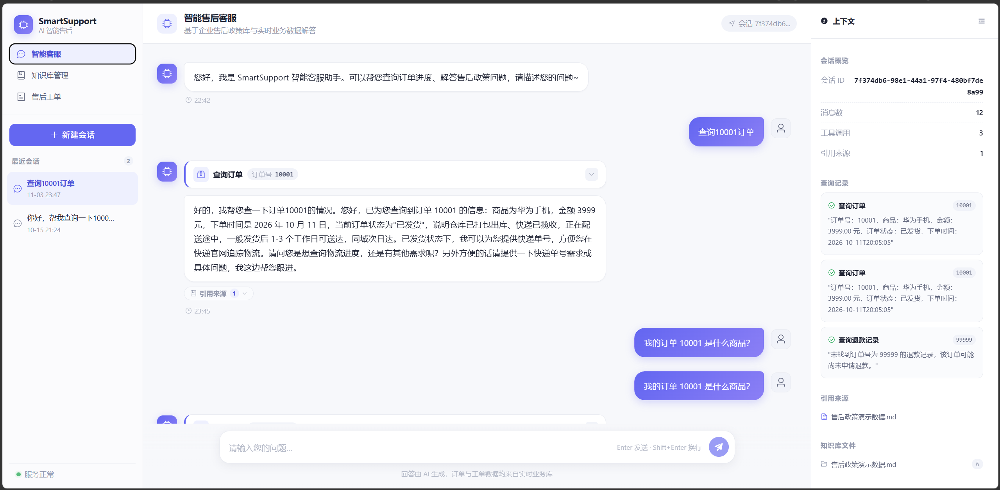
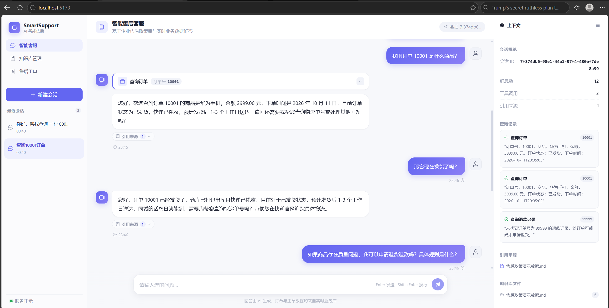
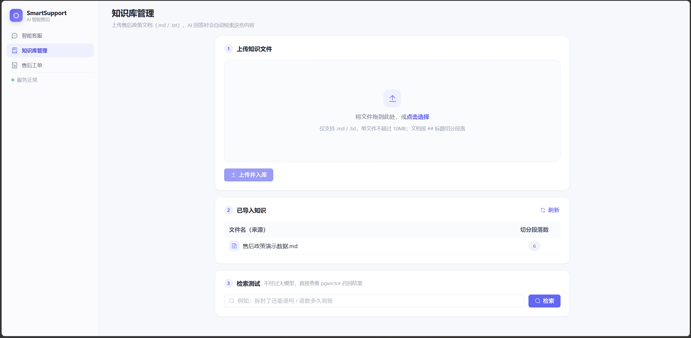
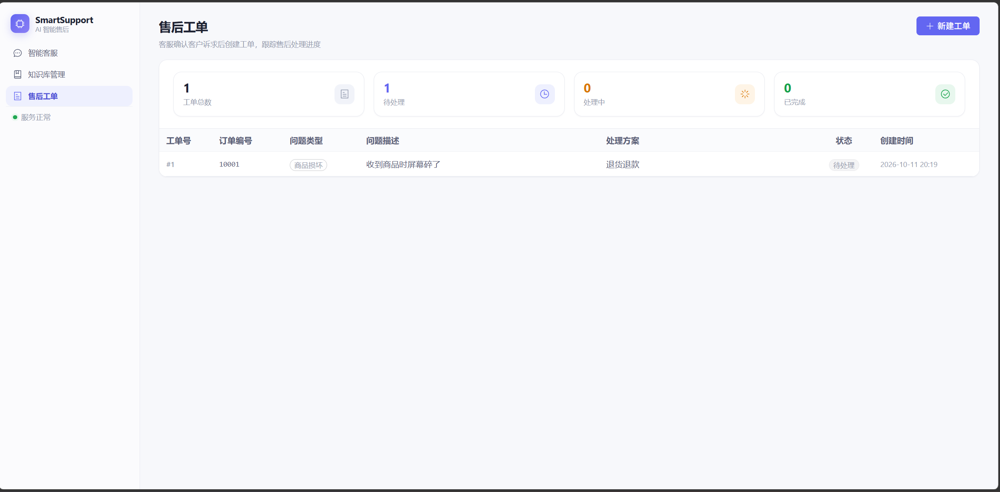
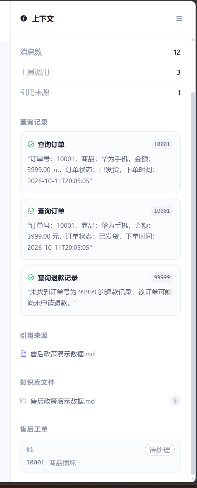

# SmartSupport AI —— 企业智能售后助手

> 基于 **Java + Python 双栈（Spring AI + FastAPI + LangChain/LangGraph + RAG + Tool Calling + MCP）** 的企业售后智能客服系统。
> Java 版（`backend`，8080）保障主链路稳定；Python 版（`python-service`，8001）承载 ReAct Agent、知识运营（512/50 切分入库）、MCP 对外接入与 LLM 生成评估。两栈共用同一批 MySQL / Redis / pgvector / DeepSeek / 百炼 Key。
> 把售后政策文档导入向量库，让 AI 基于真实政策回答问题；再挂载订单 / 退款 / 工单查询工具，让 AI 说出**真实业务数据**而不是编造。

[](https://spring.io/projects/spring-boot)
[](https://docs.spring.io/spring-ai/reference/)
[](https://vuejs.org/)
[](https://openjdk.org/)
[](https://www.mysql.com/)
[](https://github.com/pgvector/pgvector)
[](https://www.python.org/)
[](https://fastapi.tiangolo.com/)
[](https://www.langchain.com/)
[](https://langchain-ai.github.io/langgraph/)
[](https://modelcontextprotocol.io/)

---

## 目录

- [项目背景](#项目背景)
- [功能演示](#功能演示)
- [核心功能](#核心功能)
- [技术栈](#技术栈)
- [系统架构](#系统架构)
- [项目目录结构](#项目目录结构)
- [环境要求](#环境要求)
- [环境变量配置](#环境变量配置)
- [本地运行步骤](#本地运行步骤)
- [API 一览](#api-一览)
- [数据库说明](#数据库说明)
- [RAG 评测](#rag-评测)
- [注意事项](#注意事项)
- [许可证](#许可证)

---

## 项目背景

企业售后场景里，客户的问题高度集中在四类：**退不退、什么时候退、运费谁出、我的单到哪了**。

传统做法有两种，都不好用：

- **静态 FAQ**：政策一改就要改文档，答不出"我家这单什么情况"。
- **纯人工客服**：重复咨询量大，且政策口径依赖个人记忆，容易答错。

本项目的思路是**把政策和数据都交给 AI**，但给 AI 划清边界：

| 客户问题类型 | 传统做法 | 本项目的选择 |
|---|---|---|
| 政策类问题（退不退、运费谁出、保修多久） | 静态 FAQ 文档 | ✅ RAG 向量检索 + LLM 基于检索到的条文作答，**不编造政策** |
| 数据类问题（我的订单到哪了） | 客服手工查库 | ✅ Tool Calling 调用真实数据库接口，**刻意裁掉 userId** |
| 越界问题（客服电话多少） | — | 检索层挡不住，靠 system prompt 的"不编造 + 建议转人工"兜底 |

> ⚠️ 本项目中的售后政策为**模拟演示数据**，仅用于技术演示，不代表任何真实企业的实际政策。

---

## 功能演示

> 📷 以下截图均采集自本机真实运行环境（后端 8080 + 前端 5173 + PostgreSQL/pgvector + Redis + MySQL），未做任何合成或伪造。

<table>
<tr>
<td width="50%" align="center"><b>1. 智能客服主界面</b></td>
<td width="50%" align="center"><b>2. RAG 知识库问答</b></td>
</tr>
<tr>
<td align="center"></td>
<td align="center"></td>
</tr>
</table>

**① 智能客服主界面** — 左侧为历史会话列表，右侧为聊天区。底部 2×2 快捷提问卡片全部是**政策类问题**（退款条件 / 运费承担 / 物流停滞 / 保修期限），点击后直接发送到聊天框。

**② RAG 知识库问答** — 向 AI 提问政策类问题，右侧「上下文」面板会显示命中的**引用来源**（章节文件名），回答内容完全基于检索到的条文。

可直接试的问题（来自知识库章节标题）：

- 什么情况下可以申请退款
- 退货的运费由谁承担
- 快递长时间没有更新应该怎么办
- 家电类商品保修多长时间

<table>
<tr>
<td width="50%" align="center"><b>3. Tool Calling 工具调用</b></td>
<td width="50%" align="center"><b>4. 知识库管理</b></td>
</tr>
<tr>
<td align="center"></td>
<td align="center"></td>
</tr>
</table>

**③ Tool Calling 工具调用** — 向 AI 提问含**具体订单号**的问题，消息气泡内会展开工具调用卡片，显示工具名（`查询订单` / `查询退款记录` / `查询售后工单`）、入参和真实返回结果：

```
订单 10001 到哪了？
订单 10001 的退款到账了吗？
订单 10001 的售后处理得怎么样了？
```

这些查询会**真实访问 MySQL**，AI 回答里的数据全部来自数据库，不是编的。

**④ 知识库管理** — 三个功能区：**上传知识文件**（拖拽 `.md` / `.txt`，≤10MB）、**已导入文件列表**（按来源文件分组显示段落数）、**向量检索测试**（输入问题查看相似度分数与命中段落）。

<table>
<tr>
<td align="center"><b>5. 售后工单管理</b></td>
</tr>
<tr>
<td align="center"></td>
</tr>
</table>

**⑤ 售后工单管理** — 工单列表 + 统计概览卡片（总数 / 待处理 / 处理中 / 已完成），右上角可新建工单。新建时状态留空，后端自动置为「待处理」。

> 📁 截图文件位于 `docs/screenshots/`：
> ```
> 01-chat.png          # 智能客服主界面
> 02-rag.png           # RAG 知识库问答与引用来源
> 03-tool-calling.png  # Tool Calling 工具调用过程
> 04-knowledge.png     # 知识库管理页
> 05-ticket.png        # 售后工单管理页
> ```

---

## 核心功能

### 1. RAG 知识库问答

售后政策 Markdown 文档按 `##` 标题切分成段落 → 阿里云百炼 `text-embedding-v4` 生成 1024 维向量 → 存入 PostgreSQL + pgvector。

提问时先做向量相似度检索，把召回的条文拼进 system prompt，LLM **只依据这些条文**作答，并返回引用来源。

- 生产配置：`topK=5`、`similarityThreshold=0.0`（详见 [RAG 评测](#rag-评测)）
- 检索异常（向量库 / Embedding 不可用）时**自动降级**为无知识回答，接口不会 500
- 命中 / 未命中走**两套不同的 system prompt**：未命中时改用"共情 + 说明现状 + 不编造 + 建议转人工"的兜底话术

### 2. Spring AI Tool Calling

三个 `@Tool` 方法把业务查询包装成 AI 可自动调用的工具，**只读，不写任何业务数据**：

| 工具名 | 对应接口 | 返回内容 |
|---|---|---|
| `queryOrderByOrderNo` | `OrderService.getByOrderNo` | 商品、金额、订单状态、下单时间 |
| `queryRefundByOrderNo` | `RefundService.getByOrderNo` | 退款原因、退款状态、申请时间 |
| `queryTicketByOrderNo` | `TicketService.getByOrderNo` | 问题类型、问题描述、处理方案、工单状态 |

模型判断问题涉及具体订单号时会自动调用这些工具。工具返回的是**自然语言文本**（而非 JSON），对 LLM 更友好。

> 🔒 **安全设计**：项目暂无登录认证体系，工具按"客服后台演示"定位实现——知道订单号即可查询。缓解措施是返回数据中**刻意裁剪掉 `userId`**，减少信息泄露面。生产环境应接入认证后校验 `order.userId == 当前用户 ID`。

### 3. Redis 会话记忆

自定义 `RedisChatMemoryRepository` 实现 Spring AI 的 `ChatMemoryRepository`：

- Key：`chat:memory:{sessionId}`，Value：消息列表 JSON，**每次全量覆盖**并刷新 **2 小时 TTL**（过期自动清理）
- 底层 `MessageWindowChatMemory` 最多保留 **20 条消息**（约 10 轮），控制每次请求的 Token 成本
- **关键设计：只存纯文本问答对**。丢弃 `SystemMessage`（每轮重新注入，存了会重复膨胀）和**工具调用消息**（带 `toolCalls` 的 assistant / `ToolResponseMessage` 必须成对出现，被窗口裁剪拆散后 DeepSeek 会直接报 400）
- 两个 AI 接口（`/ai/chat` 与 `/ai/knowledge/chat`）**共用同一个 `ChatMemory` Bean**，同一 `sessionId` 下跨接口也能接上上下文

### 4. SSE 流式响应

两个流式接口用 `SseEmitter`（300 秒超时）逐 chunk 推送，前端用 `fetch` + `ReadableStream` 手动解析 SSE：

| 接口 | 事件类型 |
|---|---|
| `POST /ai/chat/stream` | `content`（增量文本）、`done`、`error` |
| `POST /ai/knowledge/chat/stream` | `reference`（是否命中知识 + 引用来源）、`tool`（`stage=start/result`，工具名 / 入参 / 结果）、`content`、`done`、`error` |

前端 Vite 代理对 `text/event-stream` 做了 **禁缓冲**处理（`cache-control: no-cache, no-transform` + `x-accel-buffering: no`），保证逐字刷新不被代理攒包。

### 5. 知识库管理

- **上传** `.md` / `.txt` 文件（≤10MB）→ 按 `##` 标题切段 → 批量 Embedding 入库，`metadata.source` 记为原始文件名
- **文件列表**：直接查 pgvector 的 `vector_store` 表，按 `metadata->>'source'` 分组统计段落数
- **检索测试**：输入问题直接看相似度分数与命中段落

### 6. 售后工单管理

工单列表 + 统计概览（总数 / 待处理 / 处理中 / 已完成）+ 新建工单抽屉。创建时状态留空，后端 `TicketServiceImpl.create` 自动置为「待处理」，数据库层另有 `DEFAULT '待处理'` 兜底。

### 7. 业务数据接口

订单 / 退款 / 工单的查询与写入接口，统一返回 `{ code, message, data }` 结构。

---

## 技术栈

### 后端

| 类别 | 技术 | 版本 |
|---|---|---|
| 框架 | Spring Boot | 3.4.1 |
| AI | Spring AI（DeepSeek / OpenAI 兼容 / PGVector starter） | 1.0.9 |
| 语言 | Java | 17 |
| 持久层 | MyBatis-Plus | 3.5.9 |
| 业务库 | MySQL | 8.0+ |
| 向量库 | PostgreSQL + pgvector | PG 16 |
| 缓存 / 记忆 | Redis | 7 |
| 大模型 | DeepSeek `deepseek-chat` | — |
| Embedding | 阿里云百炼 `text-embedding-v4`（1024 维） | — |
| 构建 | Maven | 3.9+ |

### Python 双栈（AI 应用能力扩展）

| 类别 | 技术 | 说明 |
|---|---|---|
| 框架 | FastAPI + uvicorn | 端口 8001，与 Java 版共用同一批中间件与 Key |
| 编排 | LangChain 0.3+ / LangGraph 0.2+ | 固定 RAG 管线 + `create_react_agent` 自主规划 |
| 切分 | LangChain Text Splitters | 按 `##` 粗切、超长按 512/50 细切入库，支持切分预览 |
| 协议 | MCP（FastMCP / MCPServer 2.x，stdio） | 4 个查询工具对外暴露，可供 Dify / Claude Desktop 接入 |
| 评估 | 自研检索评测 + LLM-as-Judge 生成评估 | 33 条检索 + 30 条端到端，Hit@K / MRR / 忠实度 / 工具选型 / 越界拒答 |
| 可观测 | SQLite（`ops.db`）+ `/py/ops/*` | 延迟 p50/p95、Token、工具数、成功率、分链路统计 |

> 📁 Python 服务详情见 [`python-service/README.md`](python-service/README.md)。

### 前端

| 类别 | 技术 | 版本 |
|---|---|---|
| 框架 | Vue | 3.5（`<script setup>`） |
| UI | Element Plus | 2.9 |
| HTTP | Axios | 1.7 |
| 构建 | Vite | 5.4 |

---

## 系统架构

```
┌──────────────────────────────────────────────────────────────────────┐
│                        浏览器 (Vue 3 + Element Plus)                    │
│   智能客服 ChatView  │  知识库管理 KnowledgeView  │  售后工单 TicketView    │
└───────────────┬──────────────────────────────┬───────────────────────┘
                │ /ai/*  (SSE)                 │ /api/*
                └──────────────┬───────────────┘
                               │ Vite 代理 (5173 → 8080)
┌──────────────────────────────┴───────────────────────────────────────┐
│                     Spring Boot 3.4.1  (端口 8080)                      │
│                                                                          │
│  ┌────────────────┐  ┌──────────────────┐  ┌────────────────────────┐  │
│  │ AiChatController│ │AiKnowledgeController│ │ Order/Refund/Ticket   │  │
│  │  /ai/chat      │  │ /ai/knowledge/*   │ │      Controller        │  │
│  │  /ai/chat/stream│ │ /chat  /chat/stream│ │      /api/*            │  │
│  └───────┬────────┘  └────────┬──────────┘  └───────────┬────────────┘  │
│          │                    │                         │               │
│  ┌───────▼────────────────────▼─────────────────────────▼────────────┐  │
│  │  ChatClient (Spring AI)                                          │  │
│  │   └─ RetryableChatModel   流式网络异常重试兜底                      │  │
│  │   └─ MessageChatMemoryAdvisor  多轮记忆                            │  │
│  └───────┬──────────────┬──────────────────────────┬─────────────────┘  │
│          │              │                          │                    │
│  ┌───────▼──────┐ ┌─────▼──────────┐  ┌────────────▼──────────────┐  │
│  │ DeepSeek API │ │  PgVectorStore  │  │  AfterSaleQueryTools      │  │
│  │  (deepseek-  │ │  → 向量相似度    │  │  @Tool × 3（只读）        │  │
│  │   chat)      │ │    检索          │  │  ↓                        │  │
│  └──────────────┘ └────┬───────────┘  │  OrderService             │  │
│                         │              │  RefundService             │  │
│  ┌──────────────┐ ┌────▼───────────┐  │  TicketService            │  │
│  │ 百炼 Embedding│ │  PostgreSQL    │  └────────────┬──────────────┘  │
│  │ text-embedding│ │  + pgvector    │               │                 │
│  │     -v4       │ │  (库: knowledge)│               ▼                 │
│  └──────────────┘ └────────────────┘        ┌────────────────┐        │
│                                               │     MySQL      │        │
│  ┌──────────────┐                            │  (库: smart_    │        │
│  │    Redis     │                            │    support)    │        │
│  │ chat:memory: │                            └────────────────┘        │
│  │  {sessionId} │                                                      │
│  └──────────────┘                                                      │
└──────────────────────────────────────────────────────────────────────┘
```

### 关键设计说明

**1. 双数据源隔离**

`PgVectorDataSourceConfig` 里 MySQL 显式标 `@Primary` 保持业务代码不受影响；PG 单独用 `@Value` + `DataSourceBuilder.url()` 构建（**不能**用 `@ConfigurationProperties` 绑定 HikariCP——它的属性名是 `jdbcUrl` 而非 `url`，直接绑定会丢 url 字段并报 `jdbcUrl is required`）。同时排除 `PgVectorStoreAutoConfiguration`，防止向量误写进 MySQL。

**2. 提示词拆两段**

system 指令每轮重新注入（**不进历史**），user 问题单独进历史。这样 Redis 里存的是干净的问答对，不会把大段政策上下文重复塞进每一轮历史，省 Token。

**3. `RetryableChatModel` 重试兜底**

JDK HttpClient 复用被对端关闭的连接会收到 RST（表现为 `Connection reset`）。Spring AI 的流式路径缺少重试，该装饰器在**尚未吐出任何内容时**做指数退避重试（最多 2 次，初始 1s、上限 4s，且只对瞬时网络错误生效），重试发生在记忆顾问内侧，不会重复写入聊天记忆。同步路径则由 `spring.ai.retry` 负责（`max-attempts: 5`，不开启 `on-client-errors`，避免重试 401 这类不可恢复错误）。

**4. 检索层不拦截越界问题**

`threshold=0.0` 时检索层挡不住越界问题（详见评测报告），这是**已知局限**，兜底靠 LLM 的 system prompt 而非检索层。

---

## 项目目录结构

```
.
├── README.md                       # 本文件
├── .env.example                    # 环境变量清单（仅供参考，见下文说明）
├── .gitignore                      # 统一忽略规则
├── 售后政策演示数据.md              # RAG 知识库源文档（模拟政策）
│
├── backend/                        # ===== 后端 =====
│   ├── pom.xml                     # Maven 依赖与版本管理
│   ├── docker-compose.yml          # Redis + PostgreSQL/pgvector 编排
│   ├── eval/                       # RAG 评测
│   │   ├── RAG-评测报告.md          # 完整评测报告
│   │   ├── gen-report.mjs          # 报告生成脚本
│   │   └── analyze-threshold.mjs   # 阈值扫描分析
│   └── src/
│       ├── main/
│       │   ├── java/com/smartsupport/
│       │   │   ├── SmartSupportApplication.java   # 启动类
│       │   │   ├── ai/
│       │   │   │   ├── AiChatController.java      # /ai/chat, /ai/chat/stream
│       │   │   │   ├── AiKnowledgeController.java # /ai/knowledge/*
│       │   │   │   ├── RetryableChatModel.java    # 流式重试装饰器
│       │   │   │   ├── RedisChatMemoryRepository.java # Redis 记忆实现
│       │   │   │   └── tool/AfterSaleQueryTools.java # 3 个 @Tool 查询工具
│       │   │   ├── config/
│       │   │   │   ├── ChatMemoryConfig.java       # MessageWindowChatMemory
│       │   │   │   ├── PgVectorDataSourceConfig.java # MySQL @Primary + PG 独立
│       │   │   │   └── PgVectorStoreConfig.java    # 手建 PgVectorStore
│       │   │   ├── controller/                      # Health / Order / Refund / Ticket
│       │   │   ├── entity/                         # Order / RefundRecord / AfterSaleTicket
│       │   │   ├── mapper/                         # BaseMapper × 3
│       │   │   ├── service/                        # 接口 + impl
│       │   │   ├── eval/RagEvalController.java     # /eval/rag/*
│       │   │   └── common/Result.java              # 统一返回结构
│       │   └── resources/
│       │       ├── application.yml                 # 所有配置
│       │       ├── db/schema.sql                   # ★ MySQL 初始化脚本
│       │       ├── eval/rag-eval-cases.json        # 评测用例集（33 条）
│       │       └── knowledge/*.txt                 # 知识库样例文档
│       └── test/java/.../RetryableChatModelTest.java # JUnit 5 + AssertJ
│
├── frontend/                       # ===== 前端 =====
│   ├── package.json
│   ├── vite.config.js              # 代理 /ai 与 /api → 8080，SSE 禁缓冲
│   └── src/
│       ├── main.js  App.vue
│       ├── api/                    # axios 封装 + chat/ticket/knowledge
│       ├── components/             # 17 个通用组件
│       ├── views/                  # ChatView / KnowledgeView / TicketView
│       └── styles/                 # theme / chat / index
│
├── python-service/                 # ===== Python 双栈（FastAPI，端口 8001）=====
│   ├── README.md                   # Python 服务说明（含接口/评测/可观测/MCP）
│   ├── requirements.txt
│   ├── app/                        # FastAPI 应用
│   │   ├── main.py                 # /py/* 接口（RAG/Agent/知识运营/ops）
│   │   ├── agent.py                # 固定 RAG 管线（与 Java 同语义）
│   │   ├── workflow.py             # LangGraph ReAct Agent
│   │   ├── ingest.py               # ## 粗切 + 512/50 细切入库
│   │   ├── tools.py                # 订单/退款/工单/保修 4 工具
│   │   ├── vectorstore.py          # pgvector 检索（topK/threshold）
│   │   ├── memory.py               # Redis 会话记忆（与 Java 共用 key）
│   │   ├── metrics.py              # SQLite 可观测落库
│   │   └── mcp_server.py           # MCP stdio 服务（4 工具对外）
│   └── eval/                       # eval_rag.py（检索）+ eval_answer.py（LLM-as-Judge 生成评估）
│
└── docs/
    └── screenshots/                # ★ README 截图（需自行放置）
        ├── 01-chat.png
        ├── 02-rag.png
        ├── 03-tool-calling.png
        ├── 04-knowledge.png
        └── 05-ticket.png
```

---

## 环境要求

| 依赖 | 版本要求 | 说明 |
|---|---|---|
| **JDK** | **17+** | Spring Boot 3.x 最低要求 |
| **Maven** | 3.6+ | 或使用项目内 `.tools/apache-maven-3.9.9` |
| **Node.js** | 18+ | Vite 5 要求 |
| **MySQL** | **8.0+** | 见下方[数据库说明](#数据库说明) |
| **PostgreSQL + pgvector** | PG 16 + pgvector | 官方推荐用 Docker 启动 |
| **Redis** | 7.x | 官方推荐用 Docker 启动 |
| **Docker / Docker Compose** | 建议 | 用于一键起 PG + Redis |

### 关于 API Key

需要两个第三方 Key：

- **DeepSeek** — 用于对话与工具调用，https://platform.deepseek.com/api_keys
- **阿里云百炼** — 用于 Embedding，https://bailian.console.aliyun.com/

---

## 环境变量配置

> ⚠️ **重要：`.env.example` 仅供参考，Spring Boot 不会自动读取 `.env` 文件。**
>
> `.env.example` 只是一个**变量名清单**，用于让你知道需要哪些变量、对应到哪个配置项。Spring Boot 不会加载 `.env`，所以**照抄 `.env.example` 并不会让配置生效**。你必须把变量**真正设置到系统环境变量里**，或用启动参数 / JVM 参数显式传入。
>
> `.env` 文件本身只对 **Docker Compose** 有效（`docker-compose.yml` 会自动读取同目录的 `.env`），对 Spring Boot 无效。
>
> 同理，`application.yml` 里的 `${DEEPSEEK-KEY}` 写法依赖**真实环境变量名**，而不是 `.env` 文件里的 `DEEPSEEK-KEY=` 这一行。

### 需要设置的 4 个变量

| 变量名 | 用途 | 对应配置项 | 缺失后果 |
|---|---|---|---|
| `DEEPSEEK-KEY` | DeepSeek 对话模型 | `spring.ai.deepseek.api-key` | AI 接口返回"AI 调用失败" |
| `ALIYUN-KEY` | 百炼 Embedding | `spring.ai.openai.embedding.api-key` | RAG 检索降级为空，无引用来源 |
| `MYSQL_PASSWORD` | MySQL root 密码 | `spring.datasource.password` | **应用启动失败**（刻意设计） |
| `PG_PASSWORD` | PostgreSQL 密码 | `pgvector.datasource.password` + compose 的 `POSTGRES_PASSWORD` | 向量库连接失败 / compose 报错退出 |

### Windows PowerShell（当前会话生效）

```powershell
$env:DEEPSEEK-KEY="sk-your-deepseek-key"
$env:ALIYUN-KEY="sk-your-bailian-key"
$env:MYSQL_PASSWORD="your-mysql-root-password"
$env:PG_PASSWORD="your-postgres-password"
```

### Windows CMD（当前会话生效）

```cmd
set DEEPSEEK-KEY=sk-your-deepseek-key
set ALIYUN-KEY=sk-your-bailian-key
set MYSQL_PASSWORD=your-mysql-root-password
set PG_PASSWORD=your-postgres-password
```

### Linux / macOS

```bash
export DEEPSEEK-KEY="sk-your-deepseek-key"
export ALIYUN-KEY="sk-your-bailian-key"
export MYSQL_PASSWORD="your-mysql-root-password"
export PG_PASSWORD="your-postgres-password"
```

### 永久生效（Windows 系统级）

```
「此电脑」右键 → 属性 → 高级系统设置 → 环境变量 → 新建/编辑上述 4 个变量
```

> 💡 也可以不用环境变量，改为启动时传参（覆盖 `application.yml`）：
>
> ```powershell
> mvn spring-boot:run "-Dspring-boot.run.jvmArguments=-DMYSQL_PASSWORD=xxx -DDEEPSEEK-KEY=xxx"
> ```
>
> 注意 `DEEPSEEK-KEY` 含连字符，在 PowerShell 中作为环境变量名可用，但在 JVM `-D` 参数里建议改用 `-Dspring-boot.run.arguments=--spring.ai.deepseek.api-key=xxx`。

### Docker Compose 用的 `.env`

只有 **Docker Compose** 会读 `.env` 文件。由于 `docker-compose.yml` 位于 `backend/` 且执行命令是 `cd backend && docker compose up -d`，请把 `.env` 放在 **`backend/` 目录**下：

```bash
cd backend
cp ../.env.example .env      # Linux / macOS
copy ..\.env.example .env    # Windows
```

然后编辑 `backend/.env` 填入真实值（**该文件已被 `.gitignore` 排除，不会提交**）。

> ⚠️ 但这只解决 compose 的问题，**Spring Boot 侧仍需按上面的方式设置系统环境变量**——compose 读到的 `.env` 不会传递给 JVM 进程。

---

## 本地运行步骤

### 步骤 1 — 启动 PostgreSQL + Redis（Docker Compose）

```bash
cd backend
docker compose up -d
```

启动后：

- PostgreSQL + pgvector → `localhost:5432`，数据库 `knowledge`，用户 `postgres`
- Redis → `localhost:6379`

> ⚠️ `docker-compose.yml` 中 `POSTGRES_PASSWORD: ${PG_PASSWORD:?PG_PASSWORD is required}` —— **未提供 `PG_PASSWORD` 时 compose 会直接报错退出**，这是刻意设计，避免使用弱口令默认值。所以执行前请先设置好 `PG_PASSWORD` 环境变量（或在 `backend/.env` 里配置）。

验证：

```bash
docker compose ps
```

> 💡 **pgvector 扩展无需手动创建**。`PgVectorStoreConfig` 里设了 `initializeSchema(true)`，Spring AI 首次启动时会自动执行 `CREATE EXTENSION IF NOT EXISTS vector` / `hstore` / `"uuid-ossp"` 并建好 `vector_store` 表。前提是 `postgres` 用户有建扩展的权限（官方 `pgvector/pgvector` 镜像默认具备）。

停止 / 清理：

```bash
docker compose stop          # 停止
docker compose down         # 停止并删除容器
docker compose down -v      # 连同数据卷一起删除（会清空向量库）
```

### 步骤 2 — 初始化 MySQL 数据库

项目使用**本机安装的 MySQL 8.0**（不使用 Docker），库名 `smart_support`。

> ⚠️ **数据库初始化脚本需要 MySQL 8.0 及以上**。
>
> 脚本使用了 `utf8mb4_0900_ai_ci` 排序规则和 MySQL 8.0.19+ 引入的 `INSERT ... AS alias` 行别名语法，**在 MySQL 5.7 上会直接报语法错误**。如果你的环境是 5.7，请把排序规则改为 `utf8mb4_general_ci`，并把 `ON DUPLICATE KEY UPDATE` 中的 `demo.\`col\`` 改回 `VALUES(\`col\`)`。

**方式 A（推荐，一条命令完成建库 + 建表 + 灌数据）**

```bash
mysql -u root -p < backend/src/main/resources/db/schema.sql
```

脚本内部已经包含 `CREATE DATABASE IF NOT EXISTS smart_support` 和 `USE smart_support`，无需预先建库。

**方式 B（先建库，再执行）**

```bash
mysql -u root -p -e "CREATE DATABASE IF NOT EXISTS smart_support DEFAULT CHARACTER SET utf8mb4;"
mysql -u root -p smart_support < backend/src/main/resources/db/schema.sql
```

**方式 C（Navicat / MySQL Workbench 图形化执行）**

1. 连接本机 MySQL 8.0
2. 打开 `backend/src/main/resources/db/schema.sql`
3. 直接运行整个脚本

**脚本行为说明**

- 建表使用 `CREATE TABLE IF NOT EXISTS` —— 表已存在则跳过，**不清空已有数据**
- 演示数据使用 `INSERT ... ON DUPLICATE KEY UPDATE` —— 遇到主键或 `order_no` 唯一键冲突时**更新该行**，而不是报错或插入重复行
- **脚本内不含 `DROP TABLE`，也不含 `DELETE FROM`**，不会删除库中其他数据
- 时间全部为**固定字面量**（不含 `NOW()`），保证演示数据可复现，并能体现"超时未发货""运输超时"等依赖时间差的业务场景
- ⚠️ 重复执行时，**相同订单编号（如 `10001`）的演示数据会被覆盖更新**为脚本中定义的商品、金额、状态与时间

**演示数据内容**

| 表 | 行数 | 覆盖状态 |
|---|---|---|
| `orders` | 7 | 已下单×2、已发货×1、运输中×2、已完成×2 |
| `refund_record` | 3 | 审核中×1、已退款×1、已到账×1 |
| `after_sale_ticket` | 4 | 待处理×2、处理中×1、已完成×1 |

其中 **`order_no = '10001'`** 是主锚点：三个查询工具的 `@ToolParam` 示例值都是 `10001`，保证 AI 演示时能查到真实数据。订单号 `10001`~`10007` 均能通过 `/api/order/{orderNo}` 访问。

### 步骤 3 — 启动后端

```bash
cd backend
mvn spring-boot:run
```

或者：

```bash
cd backend
mvn clean package -DskipTests
java -jar target/smart-support-backend-1.0.0.jar
```

后端监听 **8080**。验证：

```bash
curl http://localhost:8080/health
curl http://localhost:8080/db-check
curl http://localhost:8080/api/order/list
```

> `db-check` 会实际执行 `SELECT VERSION()` 和 `SELECT DATABASE()`，能返回结果就说明网络通、账号密码对、库存在。

> 💡 若你的机器没装 Maven，可用项目内置的 Maven 发行版（Windows）：
>
> ```powershell
> .tools\apache-maven-3.9.9\bin\mvn.cmd spring-boot:run
> ```
>
> 注意 `.tools/` 已被 `.gitignore` 排除，**只有本地开发机才有**，克隆仓库的其他人需自备 Maven。

### 步骤 4 — 导入知识库到向量库

后端启动后，把售后政策导入 pgvector：

```bash
curl -X POST http://localhost:8080/ai/knowledge/import-policy
```

或者在**前端「知识库管理」页**上传 `.md` / `.txt` 文件。

> `import-policy` 默认读取 `../售后政策演示数据.md`（相对 `backend/` 运行目录，即项目根目录下的政策文档）。可用配置项 `smartsupport.knowledge.policy-file` 覆盖路径。

### 步骤 5 — 启动前端

```bash
cd frontend
npm install
npm run dev
```

前端监听 **5173**，访问 http://localhost:5173 。

Vite 已配置代理：`/ai` 与 `/api` 转发到 `http://localhost:8080`，开发环境不产生跨域问题。SSE 响应做了禁缓冲处理，可正常逐字刷新。

### 步骤 6 — 运行单元测试

```bash
cd backend
mvn test
```

`RetryableChatModelTest` 覆盖流式重试逻辑（JUnit 5 + AssertJ）。

### 步骤 7 — 启动 Python 双栈服务（FastAPI，端口 8001，可选但推荐）

Python 版与 Java 版共用同一批中间件与 Key（MySQL / Redis / pgvector / DeepSeek / 百炼），提供 ReAct Agent、知识运营、MCP 与生成评估能力。

```powershell
cd python-service
pip install -r requirements.txt

$env:DEEPSEEK_API_KEY="sk-..."   # 或 DEEPSEEK-KEY（二选一）
$env:ALIYUN_API_KEY="sk-..."     # 或 ALIYUN-KEY（二选一）
$env:MYSQL_PASSWORD="..."
$env:PG_PASSWORD="..."

python -m uvicorn app.main:app --port 8001
```

验证：`curl http://localhost:8001/health`，详情见 [`python-service/README.md`](python-service/README.md)。

---

## API 一览

所有接口统一返回 `{ code, message, data }`，`code=200` 表示成功。

### 健康检查

| 方法 | 路径 | 说明 |
|---|---|---|
| GET | `/health` | 应用存活检查 |
| GET | `/db-check` | MySQL 连通性检查（实际执行 SQL） |

### AI 对话

| 方法 | 路径 | 说明 |
|---|---|---|
| POST | `/ai/chat` | 同步对话（带 RAG + 记忆 + 工具） |
| POST | `/ai/chat/stream` | SSE 流式对话 |

请求体：`{"message": "你好", "sessionId": "可选，续聊时传上次返回的 sessionId"}`

### AI 知识库

| 方法 | 路径 | 说明 |
|---|---|---|
| POST | `/ai/knowledge/import-policy` | 导入售后政策文档到向量库 |
| POST | `/ai/knowledge/upload` | 上传 md/txt 并入库（multipart，字段名 `file`） |
| GET | `/ai/knowledge/files` | 已导入文件列表（含段落数） |
| GET | `/ai/knowledge/search?query=` | 向量检索测试 |
| POST | `/ai/knowledge/chat` | 同步问答（带 RAG + 记忆 + 工具） |
| POST | `/ai/knowledge/chat/stream` | SSE 流式问答（多 `reference` / `tool` 事件） |

请求体：`{"question": "退款需要多久到账", "sessionId": "可选"}`

### 业务数据

| 方法 | 路径 | 说明 |
|---|---|---|
| GET | `/api/order/list` | 订单列表 |
| GET | `/api/order/{orderNo}` | 订单详情 |
| POST | `/api/order` | 新增订单 |
| GET | `/api/refund/list` | 退款记录列表 |
| GET | `/api/refund/{orderNo}` | 退款记录详情 |
| GET | `/api/ticket/list` | 工单列表 |
| GET | `/api/ticket/{orderNo}` | 工单详情 |
| POST | `/api/ticket` | 创建工单（status 留空 → 「待处理」） |

### RAG 评测

| 方法 | 路径 | 说明 |
|---|---|---|
| GET | `/eval/rag/knowledge-base` | 知识库信息 |
| GET | `/eval/rag/dataset` | 评测用例集 |
| POST | `/eval/rag/run?topKs=&thresholds=` | 批量评测（**只读**，仅对 `vector_store` 做 SELECT） |

### Python 双栈（FastAPI 8001，`/py/*`）

| 方法 | 路径 | 说明 |
|---|---|---|
| GET | `/health` | Python 服务存活检查 |
| GET | `/py/knowledge/search?query=&topK=` | 向量检索测试 |
| POST | `/py/knowledge/chat` / `/py/knowledge/chat/stream` | 固定 RAG 管线（与 Java 同语义，SSE 含 reference/tool/content/done） |
| POST | `/py/agent/chat` / `/py/agent/chat/stream` | LangGraph ReAct Agent（自主规划多工具调用） |
| POST | `/py/knowledge/preview-split` | 只切分不入库，预览 chunk 效果 |
| POST | `/py/knowledge/import-text` | 文本切分→embedding→pgvector 入库 |
| POST | `/py/knowledge/upload` | 上传 md/txt 并入库（multipart，字段名 `file`） |
| GET | `/py/ops/stats` | 调用量/成功率/延迟 p50/p95/Token/工具均值/分链路统计 |
| GET | `/py/ops/recent?limit=` | 最近调用明细 |

---

## 数据库说明

MySQL 业务库 `smart_support`，三张表通过 `order_no` **字符串逻辑关联**，**不建物理外键**（代码中无任何 JOIN，外键对代码零收益，反而会阻塞删除并增加部署摩擦）。

| 表名 | 主键 | 唯一索引 | 列数 |
|---|---|---|---|
| `orders` | `id` BIGINT AUTO_INCREMENT | `uk_order_no (order_no)` | 7 |
| `refund_record` | `id` BIGINT AUTO_INCREMENT | `uk_refund_order_no (order_no)` | 5 |
| `after_sale_ticket` | `id` BIGINT AUTO_INCREMENT | `uk_ticket_order_no (order_no)` | 7 |

### 为什么 `order_no` 必须有唯一索引？

业务层查询用的是 `selectOne`：

```java
orderMapper.selectOne(new LambdaQueryWrapper<Order>().eq(Order::getOrderNo, orderNo));
```

MyBatis-Plus 的 `selectOne` **不带 `LIMIT 1`**，命中多行时直接抛 `TooManyResultsException` → HTTP 500。没有唯一约束，重复的 `order_no` 会让查询接口直接报错。

> 💡 业务上"一单一退"是当前实现的假设。若未来放开为"一单多笔退款"，唯一索引与 `selectOne` 需同步改造。

### 表结构

<details>
<summary><b>orders（订单表）</b></summary>

| 字段 | 类型 | 约束 | 说明 |
|---|---|---|---|
| `id` | BIGINT | PK, AUTO_INCREMENT | 订单 ID |
| `order_no` | VARCHAR(20) | NOT NULL, UNIQUE | 订单编号，如 `10001` |
| `user_id` | BIGINT | NULL | 下单用户 ID（无对应用户表） |
| `product_name` | VARCHAR(100) | NULL | 商品名称 |
| `amount` | DECIMAL(10,2) | NULL | 订单金额（BigDecimal，不用 DOUBLE） |
| `status` | VARCHAR(20) | NOT NULL | 已下单 / 已发货 / 运输中 / 已完成 |
| `create_time` | DATETIME | NOT NULL | 下单时间 |

</details>

<details>
<summary><b>refund_record（退款记录表）</b></summary>

| 字段 | 类型 | 约束 | 说明 |
|---|---|---|---|
| `id` | BIGINT | PK, AUTO_INCREMENT | 退款记录 ID |
| `order_no` | VARCHAR(20) | NOT NULL, UNIQUE | 关联订单编号 |
| `refund_reason` | VARCHAR(255) | NULL | 退款原因 |
| `refund_status` | VARCHAR(20) | NULL | 审核中 / 已退款 / 已到账 |
| `create_time` | DATETIME | NOT NULL | 申请时间 |

</details>

<details>
<summary><b>after_sale_ticket（售后工单表）</b></summary>

| 字段 | 类型 | 约束 | 说明 |
|---|---|---|---|
| `id` | BIGINT | PK, AUTO_INCREMENT | 工单 ID |
| `order_no` | VARCHAR(20) | NOT NULL, UNIQUE | 关联订单编号 |
| `problem_type` | VARCHAR(50) | NULL | 问题类型：商品质量问题 / 七天无理由退货 / 物流问题 / 保修 / 其他 |
| `description` | VARCHAR(1000) | NULL | 问题描述 |
| `solution` | VARCHAR(1000) | NULL | 处理方案 |
| `status` | VARCHAR(20) | NOT NULL, DEFAULT `'待处理'` | 待处理 / 处理中 / 已完成 |
| `create_time` | DATETIME | NOT NULL | 创建时间 |

</details>

> ⚠️ MyBatis-Plus 依赖 `map-underscore-to-camel-case: true`（见 `application.yml`），列名必须严格保持小写下划线形式。

---

## RAG 评测

项目内置了一套 RAG 检索评测工具（`backend/eval/`），评测集共 **33 条**用例 = **29 条可答用例** + **4 条越界探针**。

**生产配置（`topK=5, threshold=0.0`）实测结果：**

| 指标 | 数值 |
|---|---|
| Hit Rate@1 | 89.7%（26/29） |
| Hit Rate@3 | 100.0%（29/29） |
| MRR | 0.9483 |
| 平均检索延迟 | 271.0 ms |
| 最大检索延迟 | 783.9 ms |

**评测方法：**

- ground truth 用**章节标题**（chunk 正文首行 `## xxx`），不用 chunk id —— 向量库 id 由 `uuid_generate_v4()` 随机生成、跨次导入不稳定
- **严格只读**：对 `vector_store` 只有 `SELECT`，不做任何写入 / 删除 / 重置

**完整报告：** [`backend/eval/RAG-评测报告.md`](backend/eval/RAG-评测报告.md)

### Python 双栈评测（`python-service/eval/`，与 Java 同口径）

- **检索评测**（`eval_rag.py`，33 条 = 29 可答 + 4 越界探针，ground truth=章节标题，只读 `vector_store`）：
  生产参数 topK=5 下 **Hit@1 89.7%、Hit@3 100%、MRR 0.9483**（见 `python-service/eval/eval-py-result.json`），与 Java 版一致。
- **端到端生成评估**（`eval_answer.py`，LLM-as-Judge，30 条 = 政策10 + 工具12 + 越界4 + 口语4）：
  **引用忠实度 83.3%、工具选型准确率 100%、越界拒答 4/4**（见 `python-service/eval/eval-answer-result.json`），
  覆盖固定 RAG 管线（`--mode=rag`）与 LangGraph ReAct（`--mode=react`）两条链路。
- **知识运营**：文档按 `##` 粗切、超长按 512/50 细切入库，支持切分预览（`/py/knowledge/preview-split`）、文本/文件上传入库。
- **可观测**：每次 `/py/knowledge/chat` 与 `/py/agent/chat` 落库 SQLite（`ops.db`），`/py/ops/stats` 看调用量/成功率/延迟 p50/p95/Token/工具均值/RAG 命中率/分链路统计。
- **MCP**：`python -m app.mcp_server`（stdio）暴露订单/退款/工单/保修 4 工具，可供 Dify / Claude Desktop 接入。

> 📌 报告已明确列出局限：未评测答案生成质量、未评测生成层拒答、未把 `@Tool` 业务查询纳入评测、未做并发压测。样本量小，指标置信区间较宽。

---

## 注意事项

### 安全相关

1. **不要提交任何真实密钥**。`.env` 已被 `.gitignore` 排除，`.env.example` 只放变量名与占位符。
2. **`MYSQL_PASSWORD` 未设置时应用会启动失败**——这是刻意设计，避免把明文密码写进版本库。
3. **`docker-compose.yml` 无弱口令默认值**，`PG_PASSWORD` 缺失时 compose 直接报错退出。
4. **查询工具无鉴权**。项目暂无登录体系，知道订单号即可查询。缓解措施是返回数据裁掉 `userId`。**生产环境必须接入认证后校验 `order.userId == 当前用户 ID`，绝不能让用户自行传 `userId` 作为查询条件。**

### 运行相关

5. **MySQL 必须是 8.0+**，否则 `schema.sql` 会因 `utf8mb4_0900_ai_ci` 和行别名语法报语法错误。
6. **`schema.sql` 不会被自动执行**。项目未配置 `spring.sql.init`，需按[步骤 2](#步骤-2--初始化-mysql-数据库)手动执行。
7. **重复执行 `schema.sql` 会覆盖同 `order_no` 的演示数据**（`ON DUPLICATE KEY UPDATE` 的预期行为），不会删除其他数据。
8. **Redis 未启动时**：Lettuce 是懒连接，核心接口不受影响，但**多轮对话记忆会失效**（跨轮上下文丢失）。
9. **向量库未启动或 Embedding Key 无效时**：RAG 检索降级为空，AI 仍可正常对话，但不会有引用来源。
10. **`import-policy` 的文件路径**相对 `backend/` 运行目录（默认 `../售后政策演示数据.md`），从项目根目录启动时需用 `smartsupport.knowledge.policy-file` 覆盖。
11. **端口占用**：后端 8080、前端 5173、PG 5432、Redis 6379、MySQL 3306。

### 已知局限

12. **检索层挡不住越界问题**。`threshold=0.0` 时 4 条越界探针全部返回了内容（最高相似度 0.4903），兜底靠 system prompt 而非检索层。
13. **存在「一单一退」假设**（`selectOne` + 唯一索引），多笔退款场景需改造。
14. **无用户体系**，`user_id` 是孤立标识，没有对应的用户表。
15. **`findConversationIds()` 用 `KEYS` 全量扫描**，演示项目数据量小可接受，生产应改为 `SCAN` 增量遍历。
16. **政策文档为模拟数据**，不代表真实企业政策。

---

## 许可证

本项目为技术演示项目。售后政策文档（`售后政策演示数据.md`）为虚构的演示数据，不构成任何真实业务承诺。
